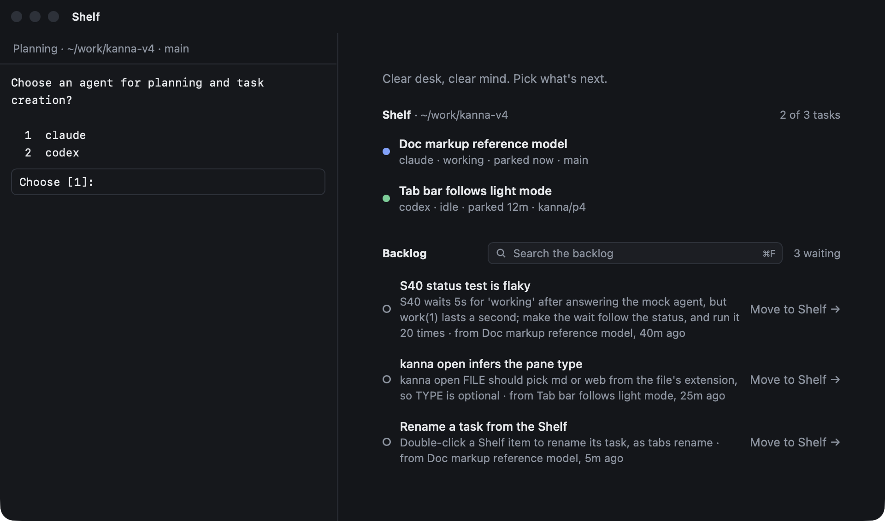
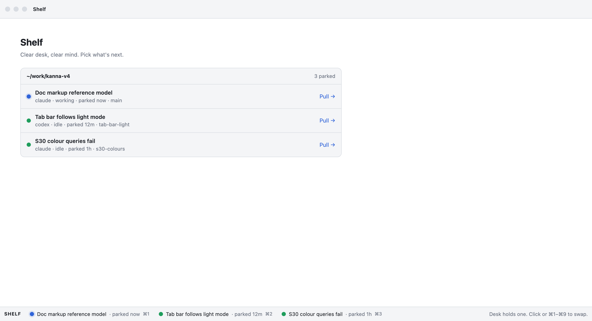
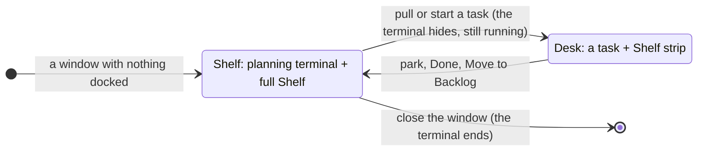
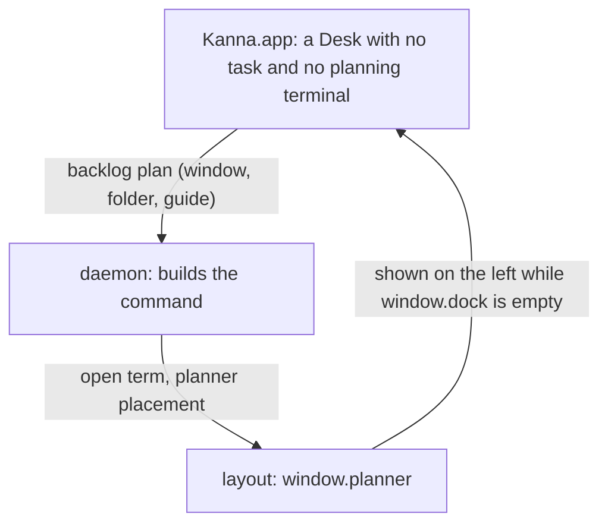

# Planning terminal

**Status:** built · **Mockup:** [`references/mockups/desk.html`](../../references/mockups/desk.html) (Park, or Simulate: no tasks) · **Builds on:** [Desk](desk.md), [tasks](tasks.md), [docked pane](docked-pane.md) · **Tests:** `scripts/e2e-kanna.sh` S45, S46

Each Desk window has a **planning terminal**: while no task is on the Desk, it's docked on the left and the full Shelf fills the right. It prints how to start, then it's your shell. The agent you start there to plan with is the window's **planning agent** ([tasks](tasks.md#2-how-tasks-are-made)), and the settings it gets are in [settings](settings.md).

## Contents

1. [When it shows](#1-when-it-shows)
2. [What it is](#2-what-it-is)
3. [Getting started](#3-getting-started)
4. [The window's folder](#4-the-windows-folder)
5. [How it's built](#5-how-its-built)
6. [Rejected](#6-rejected)
7. [Glossary](#7-glossary)

## 1. When it shows

- **Only when every task in the window is parked.** With a task on the Desk, the planning terminal and the full Shelf are out of sight, and the Shelf strip along the bottom is exactly as before.
- **The right side is the full Shelf,** where tabs would be: the running tasks of the folder's repo with their status (click to pull) and the backlog (Move to Shelf), live.
- **The Shelf holds no tabs.** New Tab and the splits are off there. A pane opened onto it (`kanna open`, from the planning agent or anywhere) opens in a plain window of its own. A Desk left with tabs but no task (its agent closed or undocked) hands them to a window of their own, or, with no planning terminal yet, becomes that plain window.
- **Hidden means still running.** Pulling a task hides the terminal, and whatever runs in it; parking brings it back as it was. It survives an app restart like any terminal.

## 2. What it is

- **Your shell, after the instructions.** It prints how to start, then hands over to your login shell, where you start your agent, quit it, `cd` and start it again as in any terminal; `claude --continue` picks the conversation up.
- **One per window.** A Desk window gets its own the first time it shows no task, and keeps it while tasks come and go. Every window is an independent Desk; there's no shared or cross-window planning terminal. Closing the window ends it.
- **Not a task.** It isn't on the Shelf, the strip or in `kanna task list`, doesn't take one of the repo's three running slots, can't be parked, pulled, moved or docked elsewhere, and has no Park button. Its header says **Planning**, the terminal's folder and branch.
- **In the window's folder, the repo's main checkout,** not a worktree.
- **Marked as the planning terminal:** `KANNA_PLANNER=1` is set in it, for the agent you start there, along with the [settings](settings.md) for it.

## 3. Getting started

- **A window with nothing in it starts here:** when Kanna opens with nothing, in every new Desk window, and on `kanna PATH`.
- **The terminal first prints** [`getting-started.md`](../../apps/kanna/Resources/getting-started.md), through `glow` if it's installed, else `cat`, wrapped by the terminal so it reflows: start your agent here, tell it what you want, Move to Shelf starts a task.

## 4. The window's folder

- **It opens in your home folder,** or in the shell's folder when Kanna is started from one (`kanna …`, which passes its working directory to the app as `KANNA_START_DIR`), or in PATH for `kanna PATH`.
- **The window follows the terminal.** `cd` it elsewhere and the header and the Shelf follow, to that folder's repo. With a task on the Desk, the task's repo is the window's.

## 5. How it's built

- **The layout keeps it as the window's `planner`**: a pane beside the window's dock (with its width), shown on the left only while the dock is empty, saved with the window. Parking and pulling move the dock and tabs and leave it in place. `move` refuses it (`planner`).
- **The layout keeps the Shelf free of tabs:** placing a pane in a Desk with no task puts it in a new window instead, and tidying moves any tabs left on one to a window of their own (or makes a Desk with no planning terminal a plain window).
- **The app asks for one** (`backlog` `plan`) when a Desk shows no task and has none, passing the window's folder and the getting-started file; it follows the terminal's folder as it reports it, as for a task's agent.
- **The daemon builds the command:** `KANNA_PLANNER` and the [settings](settings.md), the getting-started text, then `exec` of your login shell, with Kanna's zsh integration put back for it. It opens it with the `planner` placement, outside the task limit.
- **`task desk`** makes a Desk with a folder (`kanna PATH`, or Kanna started in one) or with none (started from Finder).

## 6. Rejected

- **Kanna starting the planning agent** (with a first message, a claude session to resume, and Return to start it again): a terminal that says how to start is simpler, and you choose the agent and when it runs.
- **One Shelf window for every repo, with one planning terminal:** each window stays an independent Desk, so a planning terminal belongs to its window and its folder.
- **Guessing a folder** (the latest parked or backlog task's repo) when Kanna starts with none: there's no project concept yet; the folder is where Kanna was started, else your home folder, and you `cd`.
- **The planning terminal as a task** (docked like one, in a worktree): it would take one of the three slots, show on the Shelf, and park away. It's for planning, so it stays in the main checkout and outside the task rules.
- **Showing it beside a task** (a third column, or on the strip): the Desk shows one conversation, and the strip stays as it is.
- **A Getting started tab beside a plain terminal** (before): the instructions are now in the terminal itself.
- **Tabs on the Shelf** (⌘T there, covering the full Shelf until closed): the Shelf is the Shelf; work with tabs belongs to a task.

## 7. Glossary

| Term | Meaning |
|---|---|
| **Planning terminal** | A window's own terminal, docked beside the full Shelf while no task is on the Desk; not a task |
| **Planning agent** | The agent you start in the planning terminal to plan with |
| **Full Shelf** | The right side of a Desk with no task: the running tasks and backlog of the window's repo |
| **Main checkout** | The repo's own folder, as opposed to a task's worktree |
| **Window's folder** | Where the planning terminal is: where Kanna was started, PATH, or wherever you `cd` it |
