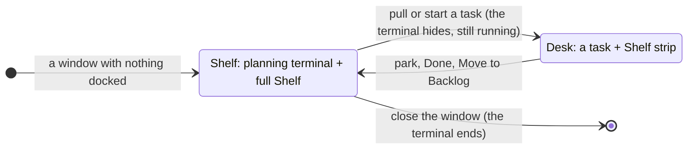
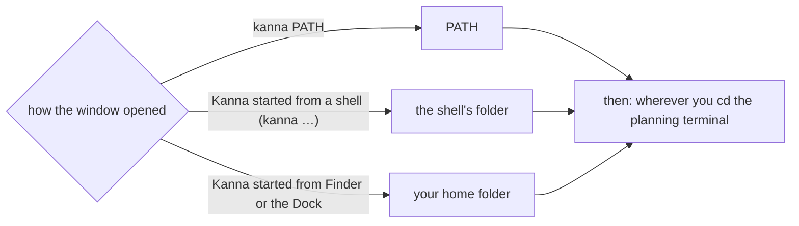
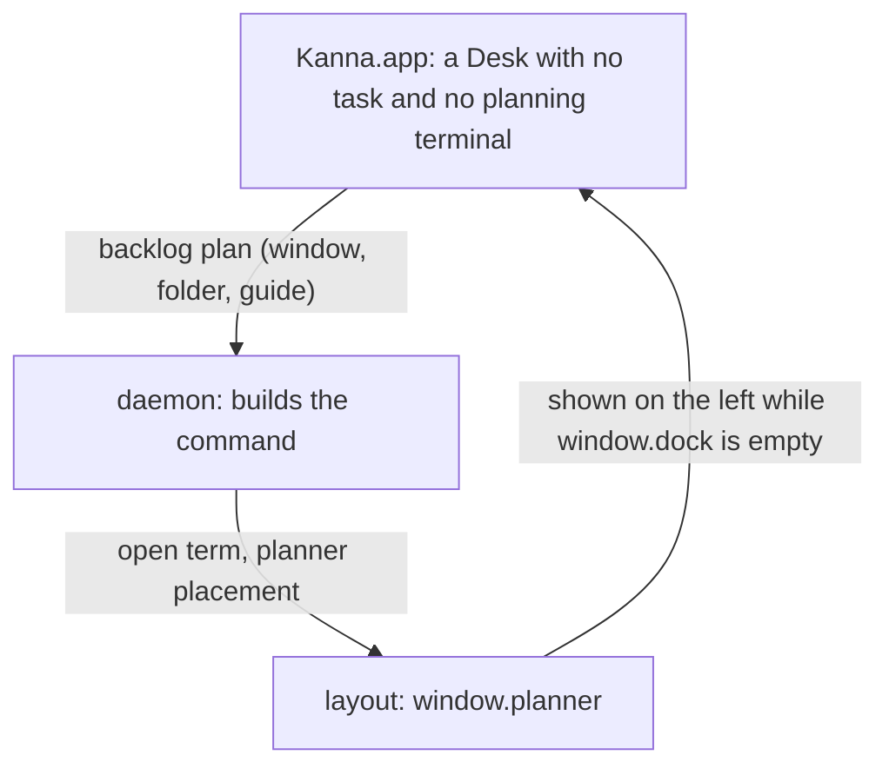

# Planning agent

**Status:** built · **Mockup:** [`references/mockups/desk.html`](../../references/mockups/desk.html) (Park, or Simulate: no tasks; type to the planning agent) · **Builds on:** [Desk](desk.md), [tasks](tasks.md), [docked pane](docked-pane.md) · **Tests:** `scripts/e2e-kanna.sh` S45, S46

Each Desk window has a **planning terminal**: while no task is on the Desk, it's docked on the left and the full Shelf fills the right. It prints how to start, then it's your shell: you start your agent there (`claude`, `codex`), and that agent is the window's **planning agent**. You say "split this into three tasks", "what's waiting?" or "start the login one", and it runs `kanna task …` for you.


## Contents

1. [When it shows](#1-when-it-shows)
2. [What it is](#2-what-it-is)
3. [Getting started](#3-getting-started)
4. [The window's folder](#4-the-windows-folder)
5. [Settings](#5-settings)
6. [Skills](#6-skills)
7. [How it's built](#7-how-its-built)
8. [Rejected](#8-rejected)
9. [Glossary](#9-glossary)

## 1. When it shows



- **Only when every task in the window is parked.** With a task on the Desk, the planning terminal and the full Shelf are out of sight, and the Shelf strip along the bottom is exactly as before.
- **The right side is the full Shelf,** where tabs would be: the running tasks of the folder's repo with their status (click to pull) and the backlog (Move to Shelf), live.
- **The Shelf holds no tabs.** New Tab and the splits are off there. A pane opened onto it (`kanna open`, from the planning agent or anywhere) opens in a plain window of its own. A Desk left with tabs but no task (its agent closed or undocked) hands them to a window of their own, or, with no planning terminal yet, becomes that plain window.
- **Hidden means still running.** Pulling a task hides the terminal, and whatever runs in it; parking brings it back as it was. It survives an app restart like any terminal.

## 2. What it is

- **A terminal, not an agent Kanna starts.** It prints how to start, then hands over to your login shell. You start your agent, quit it, `cd` and start it again as in any terminal; `claude --continue` picks the conversation up.
- **One per window.** A Desk window gets its own the first time it shows no task, and keeps it while tasks come and go. Every window is an independent Desk; there's no shared or cross-window planning terminal. Closing the window ends it.
- **Not a task.** It isn't on the Shelf, the strip or in `kanna task list`, doesn't take one of the repo's three running slots, can't be parked, pulled, moved or docked elsewhere, and has no Park button. Its header says **Planning**, the terminal's folder and branch.
- **In the window's folder, the repo's main checkout,** not a worktree: the agent there plans and doesn't write code. It sees the whole repo: every running task, its status, and the backlog.
- **Marked for your agent:** `KANNA_PLANNER=1` is set in it, so the agent knows it's the planning agent ([skills](#6-skills)), and a claude agent's context is kept to 300K tokens ([settings](#5-settings)).

## 3. Getting started

- **A window with nothing in it starts here:** when Kanna opens with nothing, in every new Desk window, and on `kanna PATH`.
- **The terminal first prints** [`getting-started.md`](../../apps/kanna/Resources/getting-started.md), through `glow` if it's installed, else `cat`, wrapped by the terminal so it reflows: start your agent here, tell it what you want, Move to Shelf starts a task.
- **There's no Getting started tab** any more.

## 4. The window's folder

There's no project concept yet: a window works in a folder, and its Shelf shows the tasks of that folder's repo.



- **The planning terminal starts in the window's folder:** the one Kanna was started in (the `kanna` CLI passes its working directory when it starts the app, as `KANNA_START_DIR`), PATH for `kanna PATH`, else your home folder.
- **The window follows the terminal.** `cd` it elsewhere and the header and the Shelf follow, to that folder's repo. With a task on the Desk, the task's repo is the window's.

## 5. Settings

Kanna's settings live in `~/.kanna-v4/config.json`, and a repo can override them in its own `.kanna/config.json` (key by key, the repo's winning). The planning terminal reads them when it's made, for the folder it starts in:

```json
{ "planning": { "context": 300000 } }
```

| Key | Default | Does |
|---|---|---|
| `planning.context` | `300000` | Tokens a claude agent's context grows to in the planning terminal before it compacts, from 100000 to 1000000, or `"auto"` for claude's own. A long-lived agent works better kept small (context rot). Kanna sets `CLAUDE_CODE_AUTO_COMPACT_WINDOW` in the terminal, unless your environment already sets it. A value out of range uses the default, and the daemon's log says so. Other agents keep their own limit (codex's is already shorter); each gets this setting as Kanna supports it. |

## 6. Skills

| Skill | For |
|---|---|
| [`kanna-planning`](../../.agents/kanna-skills/skills/kanna-planning/SKILL.md) | An agent in a planning terminal (`$KANNA_PLANNER`): say what's running and waiting, plan with you, make backlog tasks with first messages that stand alone, start or end tasks only when you ask, never write code |
| [`kanna-new-project`](../../.agents/kanna-skills/skills/kanna-new-project/SKILL.md) | An empty folder or one that isn't a repo: decide what the project is, set it up with your say-so, plan its first tasks |
| [`kanna-tasks`](../../.agents/kanna-skills/skills/kanna-tasks/SKILL.md) | A task's agent; it sends a planning agent to `kanna-planning` and tells it not to name itself |

## 7. How it's built



- **The layout keeps it as the window's `planner`**: a pane beside the window's dock (with its width), shown on the left only while the dock is empty, saved with the window. Parking and pulling move the dock and tabs and leave it in place. `move` refuses it (`planner`).
- **The layout keeps the Shelf free of tabs:** placing a pane in a Desk with no task puts it in a new window instead, and tidying moves any tabs left on one to a window of their own (or makes a Desk with no planning terminal a plain window).
- **The app asks for one** (`backlog` `plan`) when a Desk shows no task and has none, passing the window's folder and the getting-started file; it follows the terminal's folder as it reports it, as for a task's agent.
- **The daemon builds the command:** `KANNA_PLANNER` and the context limit, the getting-started text, then `exec` of your login shell, with Kanna's zsh integration put back for it. It opens it with the `planner` placement, outside the task limit.
- **`task desk`** makes a Desk with a folder (`kanna PATH`, or Kanna started in one) or with none (started from Finder).

## 8. Rejected

- **Kanna starting the planning agent** (with a first message, a claude session to resume, and Return to start it again): a terminal that says how to start is simpler, and you choose the agent and when it runs.
- **One Shelf window for every repo, with one planning agent:** each window stays an independent Desk, so a planning terminal belongs to its window and its folder.
- **Guessing a folder** (the latest parked or backlog task's repo) when Kanna starts with none: there's no project concept yet; the folder is where Kanna was started, else your home folder, and you `cd`.
- **The planning agent as a task** (docked like one, in a worktree): it would take one of the three slots, show on the Shelf, and park away. It plans, so it stays in the main checkout and outside the task rules.
- **Showing it beside a task** (a third column, or on the strip): the Desk shows one conversation, and the strip stays as it is.
- **A Getting started tab beside a plain terminal** (before): the instructions are now in the terminal itself.
- **Tabs on the Shelf** (⌘T there, covering the full Shelf until closed): the Shelf is the Shelf; work with tabs belongs to a task.
- **Settings in `~/.config/kanna/`:** `~/.kanna-v4/` and a repo's `.kanna/` keep Kanna's settings together, with a repo override beside the repo's other Kanna files.

## 9. Glossary

| Term | Meaning |
|---|---|
| **Planning terminal** | A window's own terminal, docked beside the full Shelf while no task is on the Desk; not a task |
| **Planning agent** | The agent you start in the planning terminal |
| **Full Shelf** | The right side of a Desk with no task: the running tasks and backlog of the window's repo |
| **Main checkout** | The repo's own folder, as opposed to a task's worktree |
| **Window's folder** | Where the planning terminal is: where Kanna was started, PATH, or wherever you `cd` it |
| **Compact** | An agent summarising its conversation to shrink its context, keeping what matters |
