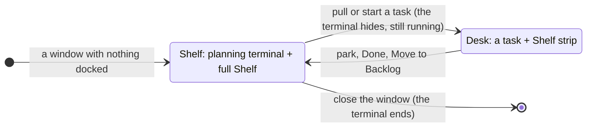

# Planning terminal

**Status:** built; Kanna starting the planning agent (`planner.sh`) is planned ([2](#2-what-it-is)) · **Mockup:** [`references/mockups/desk.html`](../../references/mockups/desk.html) (Park, or Simulate: no tasks) · **Builds on:** [Desk](desk.md), [tasks](tasks.md), [docked pane](docked-pane.md) · **Tests:** `scripts/e2e-kanna.sh` S45, S46

Each Desk window has a **planning terminal**: while no task is on the Desk, it's docked on the left and the full Shelf fills the right. Kanna starts the window's **planning agent** in it ([tasks](tasks.md#2-how-tasks-are-made)), the agent you choose, telling it it's the planner; the settings it gets are in [settings](settings.md).


## Contents

1. [When it shows](#1-when-it-shows)
2. [What it is](#2-what-it-is)
3. [Getting started](#3-getting-started)
4. [The window's folder](#4-the-windows-folder)
5. [How it's built](#5-how-its-built)
6. [Rejected](#6-rejected)
7. [Glossary](#7-glossary)

## 1. When it shows



- **Only when every task in the window is parked.** With a task on the Desk, the planning terminal and the full Shelf are out of sight, and the Shelf strip along the bottom is exactly as before.
- **The right side is the full Shelf,** where tabs would be: the running tasks of the folder's repo with their status (click to pull) and the backlog (Move to Shelf), live.
- **The Shelf holds no tabs.** New Tab and the splits are off there. A pane opened onto it (`kanna open`, from the planning agent or anywhere) opens in a plain window of its own. A Desk left with tabs but no task (its agent closed or undocked) hands them to a window of their own, or, with no planning terminal yet, becomes that plain window.
- **Hidden means still running.** Pulling a task hides the terminal, and whatever runs in it; parking brings it back as it was. It survives an app restart like any terminal.

## 2. What it is

- **A new Desk's planning terminal runs Kanna's planner script** (`planner.sh`, in the app), once: agent setup, which agent plans, the agent, then your shell.

  ```mermaid
  flowchart LR
      S["kanna agents setup --ask<br/>kanna agents update --ask"] --> P{"planning.agent set,<br/>or one agent installed?"}
      P -->|"yes"| A["the agent:<br/>'You are the Kanna planning agent.'"]
      P -->|"no"| Q["which agent plans?<br/>make it the project's?"] --> A
      A -->|"you quit it"| SH["your shell"]
  ```

- **It asks which agent plans,** from the agents Kanna knows ([which agents resume](tasks.md#which-agents-resume)) that are installed, and offers to make your choice the project's:

  ```
  Which agent plans with you?

    1  claude
    2  codex

  Choose [1]: 2
  Make codex the planning agent for kanna-v4? [y/N] y
  codex plans kanna-v4 from now on (planning.agent in .kanna/config.json).
  ```

  It doesn't ask with one agent installed, or when `planning.agent` is set in your settings or the repo's ([settings](settings.md)). Yes writes `planning.agent` to the repo's `.kanna/config.json`, which is part of the repo, so it's the project's planner for everyone; it's offered only in a git repo. With no agent installed it says so, and you're in your shell.
- **Its first message tells it it's the planner:** `You are the Kanna planning agent.` The kanna-planning skill does the rest, so the agent answers straight away with what's running and waiting.
- **It has Kanna's environment** (`KANNA_PANE`, `KANNA_SOCKET`) and the [settings](settings.md) for its agent; Codex runs with `--no-daemon` so its commands see them ([tasks](tasks.md#7-how-its-built)).
- **Quit it and you're in your shell,** in the same folder. The planner is yours from then on: start an agent there yourself (telling it it's the planner if you want one), and Kanna tells it nothing. The script runs again only when the terminal's command does: a new Desk, or the terminal restarted (`kanna restart`), which starts a new conversation.
- **One per window.** A Desk window gets its own the first time it shows no task, and keeps it while tasks come and go. Every window is an independent Desk; there's no shared or cross-window planning terminal. Closing the window ends it.
- **Not a task.** It isn't on the Shelf, the strip or in `kanna task list`, doesn't take one of the repo's three running slots, can't be parked, pulled, moved or docked elsewhere, and has no Park button. Its header says **Planning**, the terminal's folder and branch.
- **In the window's folder, the repo's main checkout,** not a worktree.

## 3. Getting started

- **A window with nothing in it starts here:** when Kanna opens with nothing, in every new Desk window (File → New Desk, ⌘N), and on `kanna PATH`.
- **Agent setup asks first** if you haven't set Kanna's skills up, or this Kanna has newer ones ([agent setup](agent-setup.md#3-asking)), once per launch.
- **Then the planning agent starts** and greets you with what's running and waiting. There's no getting-started text to read.

## 4. The window's folder

- **It opens in your home folder** (always, for File → New Desk), or in the shell's folder when Kanna is started from one (`kanna …`, which passes its working directory to the app as `KANNA_START_DIR`), or in PATH for `kanna PATH`.
- **The window follows the terminal.** `cd` it elsewhere and the header and the Shelf follow, to that folder's repo. With a task on the Desk, the task's repo is the window's.

## 5. How it's built

- **The layout keeps it as the window's `planner`**: a pane beside the window's dock (with its width), shown on the left only while the dock is empty, saved with the window. Parking and pulling move the dock and tabs and leave it in place. `move` refuses it (`planner`).
- **The layout keeps the Shelf free of tabs:** placing a pane in a Desk with no task puts it in a new window instead, and tidying moves any tabs left on one to a window of their own (or makes a Desk with no planning terminal a plain window).
- **The app asks for one** (`backlog` `plan`) when a Desk shows no task and has none, passing the window's folder; it follows the terminal's folder as it reports it, as for a task's agent.
- **The daemon builds the terminal's command:** the [settings](settings.md) (`planning.context` as an `export`), then `planner.sh` with the `kanna` beside the daemon, the folder's `planning.agent` if set, and each agent Kanna knows with the command that starts it, from the `AGENTS` table in `backlog.rs` with the planner's first message, as you'd start it yourself: no session (a planner isn't resumed) and no skipping permission prompts, then your login shell, with Kanna's zsh integration put back for it. It opens it with the `planner` placement, outside the task limit.
- **`planner.sh` (in `Contents/Resources`)** runs agent setup, keeps the agents it's given whose program your shell finds (`command -v`), asks, writes the project's `planning.agent` with `plutil` (it keeps the rest of the file), and runs the chosen command. It knows no agent itself: the table stays the daemon's.
- **`task desk`** makes a Desk with a folder (`kanna PATH`, Kanna started in one, or `~` for File → New Desk) or with none (started from Finder).

## 6. Rejected

- **Detecting the planner from its folder** (the main checkout of a repo with `.kanna-worktrees/`) **or with a hook:** an agent you start yourself in Codex's shared server never sees Kanna's environment, and a folder can't tell the planner from any agent started in the main checkout. Kanna starting the agent tells it for certain.
- **Telling it in its launch instructions** (`claude --append-system-prompt`, `codex -c developer_instructions`): an agent started with instructions and no message waits silently for you, and each agent needs its own flag. A first message works for every agent and gets an answer.
- **Saving the agent you chose as your setting** without asking: you choose per Desk, and save it for a project only when you say so.
- **A `kanna plan` command** to start or resume the planner: it only makes sense inside a Kanna planning terminal, not as a general command. Quit, the planner is yours to start.
- **Resuming the planner's conversation:** it'd need its session kept per window; the planner re-reads the Shelf and backlog when it starts, so a new conversation loses little.
- **Marking the planning terminal with an environment variable** (`KANNA_PLANNER`): the agent is told in its first message, and the daemon knows which pane is a window's planner.
- **Printing getting-started text** (before): the agent itself says what's running and waiting.

- **One Shelf window for every repo, with one planning terminal:** each window stays an independent Desk, so a planning terminal belongs to its window and its folder.
- **Guessing a folder** (the latest parked or backlog task's repo) when Kanna starts with none: there's no project concept yet; the folder is where Kanna was started, else your home folder, and you `cd`.
- **The planning terminal as a task** (docked like one, in a worktree): it would take one of the three slots, show on the Shelf, and park away. It's for planning, so it stays in the main checkout and outside the task rules.
- **Showing it beside a task** (a third column, or on the strip): the Desk shows one conversation, and the strip stays as it is.
- **A Getting started tab beside a plain terminal** (before): the instructions are now in the terminal itself.
- **Tabs on the Shelf** (⌘T there, covering the full Shelf until closed): the Shelf is the Shelf; work with tabs belongs to a task.

## 7. Glossary

| Term | Meaning |
|---|---|
| **Planning terminal** | A window's own terminal, docked beside the full Shelf while no task is on the Desk; not a task |
| **Planning agent** | The agent the planner script starts in a new Desk's planning terminal, the one you chose |
| **Full Shelf** | The right side of a Desk with no task: the running tasks and backlog of the window's repo |
| **Main checkout** | The repo's own folder, as opposed to a task's worktree |
| **Window's folder** | Where the planning terminal is: where Kanna was started, PATH, or wherever you `cd` it |
