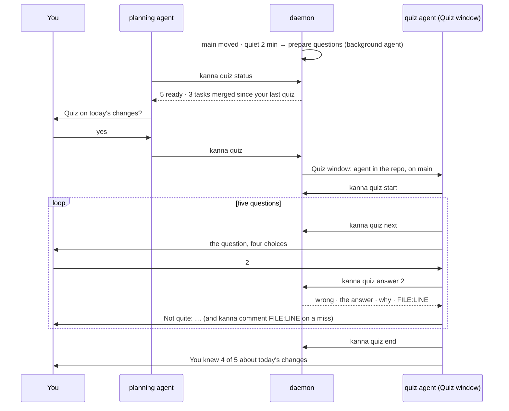
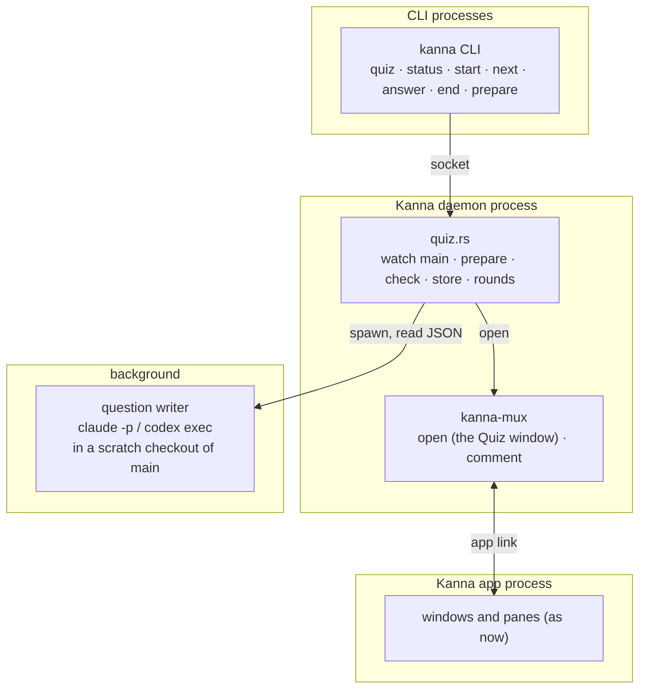
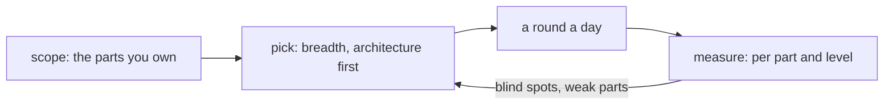

# Quiz

**Status:** planned · **Mockup:** [`references/mockups/quiz.html`](../../references/mockups/quiz.html) · **Builds on:** [code tour](code-tour.md), [planning agent](planning-agent.md), [agent setup](agent-setup.md)

Agents write code faster than you can read it, and you lose track of how your own codebase works. The **quiz** is a short break between reading agent output that keeps you up with what they built: five multiple-choice questions about what landed on main since your last quiz, asked by an agent in its chat, each answer explained, with the code opened at the line. It's the same problem the `kanna-explain` skill addresses, from the other side: you're asked, rather than told.

**Done when** `kanna quiz` plays a round on this repo's recent changes, the questions having been prepared in the background after they merged.


## Contents

1. [A round](#1-a-round)
2. [Rules](#2-rules)
3. [Questions](#3-questions)
4. [Preparing questions](#4-preparing-questions)
5. [CLI](#5-cli)
6. [The skill](#6-the-skill)
7. [How it's built](#7-how-its-built)
8. [Later: keeping you fluent](#8-later-keeping-you-fluent)
9. [Rejected](#9-rejected)
10. [Glossary](#10-glossary)

## 1. A round




## 2. Rules

- **The planning agent offers, the quiz agent asks.** The planning agent runs `kanna quiz status` when its session starts and when you come back to the empty Desk, and offers a round once when one is ready. It never asks the questions itself.
- **`kanna quiz` opens the Quiz window**: a plain window, not a Desk, named for the repo, with an agent running in the repo's own folder on main. There's no task and no worktree, since a quiz changes nothing. It takes no place on the Shelf. Running `kanna quiz` again brings that window forward.
- **The repo** is the one `kanna quiz` is run from: the Desk's project from the planning terminal, else the terminal's folder.
- **A round is five questions, one at a time,** about two minutes. The quiz agent asks each as a multiple-choice prompt: Claude's question tool, or a numbered list for an agent without one.
- **Every answer gets a short explanation**, from the stored question, and an offer to open the code. **A miss opens it straight away:** the agent runs `kanna comment FILE:LINE "why"`, so the code shows beside it with the explanation on its lines ([code tour](code-tour.md)). The code splits to the right of the agent, and later comments reuse that pane.
- **The agent never knows the answer before you do.** `kanna quiz next` gives the question without it; `kanna quiz answer` records yours and only then returns the right one.
- **Pausing is leaving.** Close the window or go back to your Desk; the round is kept, and the next `kanna quiz start` carries on from the question you were on.
- **Nothing interrupts a round.** A task that needs you shows on the Shelf in your Desk window, as always; the quiz doesn't stop for it.
- **No score to protect.** No streaks, no totals over time: the end of a round says what you knew of *these* changes ("You knew 4 of 5 about today's changes") and which topics come back.
- **Misses come back** in a later round (not the next question), with the choices shuffled. A question you get right is done.
- **Light and dark** follow the system, as every pane does.


## 3. Questions

| Kind | Example | Comes from |
|---|---|---|
| **Architecture** | Which process owns a pane's terminal: the app, the daemon, or the CLI? | the code's structure (crates, modules, who calls whom) and the specs' diagrams |
| **Behaviour** | When you Move to Backlog, what happens to the agent? | the code and commit messages |
| **Where it lives** | Which file decides a pane's status? | the code |
| **Why** | Why does an instance have its own daemon? | the specs and docs |
| **Spot the bug** | Which of these lines from today's merge has a bug put in? | a few lines from recently merged code, one changed |

- **Only what's true on main:** the code at main's commit, the specs and docs there, and the messages of the commits since the last quiz. Never an agent's conversation.
- **Architecture questions** ask how the pieces fit: which process or module owns something, how data flows between them, what talks to what. They're about what today's changes touched, seen from above.
- **Each question is about some lines**: a file, a first and last line, and the text of those lines when it was made. An architecture question's lines are where the answer is plainest: a spec's diagram, or the code where one piece hands off to another. That's what the agent opens on a miss, and what staleness is checked against.
- **A question goes when its lines change.** Each time main moves, every saved question's lines are looked up in the file at main: found unchanged (anywhere in the file), the question stays, its line numbers updated if they moved; changed or gone, the question is dropped. A spot-the-bug question checks the original lines, not the changed one.
- **Since the last quiz:** a round is drawn from questions about commits after the main commit at the end of your last round (on a first quiz, the last day of commits, at most 30).
- **Picking a round:** misses due back first (at most two), then new questions, the broader ones first (architecture before a line's detail), spread across files.

## 4. Preparing questions

```mermaid
stateDiagram-v2
    direction LR
    [*] --> idle
    idle --> moved: main's commit changed
    moved --> moved: changed again (wait restarts)
    moved --> preparing: quiet 2 min, and fewer than 10 unasked questions
    moved --> idle: 10 or more unasked already
    preparing --> idle: questions checked and saved
    preparing --> idle: failed (logged; tried again on the next change)
```



- **The daemon watches main** in each project it knows (a Desk's, or a backlog task's): every minute it reads the ref of the default branch (`main`, else `master`), which costs a file read.
- **A short-lived agent writes them**, in the background, never in a terminal: the agent command from the repo's settings (`quiz.agent`), else Claude: `claude -p --model sonnet --output-format json --max-turns 15 --allowedTools Read,Grep,Glob`, run in a scratch checkout of main's commit (`git worktree add --detach`, removed afterwards). Codex: `codex exec --sandbox read-only`.
- **The prompt** carries the material, so the agent spends its turns checking lines, not exploring: the commit messages since the last quiz, the diff (trimmed to 60 KB, specs and code first, lockfiles and generated files left out), the topics you missed, and the question kinds with an example of each. It asks for ten questions as JSON in a given shape.
- **The daemon checks every question** before saving it: four choices, one answer, its file at that commit, its lines in range, and their text read from the file by the daemon, not taken from the agent. A question that fails is dropped.
- **Kept cheap:** only when main moved, once it's been quiet two minutes, at most one run per repo at a time, only while fewer than ten unasked questions are saved, and at most four runs per repo a day. `"quiz": false` in the repo's `.kanna/config.json` turns it off.
- **On demand:** with nothing ready, `kanna quiz start` starts a run and says it's preparing; `--wait` waits for it (about a minute).

## 5. CLI

| Command | Does |
|---|---|
| `kanna quiz` | Opens the Quiz window for this repo, or brings it forward |
| `kanna quiz status` | What's ready: `5 questions ready · 3 tasks merged into main since your last quiz, yesterday 18:20`, or `nothing new since your last quiz`, or `preparing` |
| `kanna quiz start [--wait]` | Carries on the round in progress, or makes one: `round r7 · 5 questions`; with nothing ready, starts preparing and says so |
| `kanna quiz next` | The round's next question, without its answer: kind, where it comes from, the question, four choices, and lines for a spot-the-bug; `round done` after the fifth |
| `kanna quiz answer N` | Answers the current question with choice N (1–4): right or wrong, the answer, why, and `FILE:LINE` |
| `kanna quiz end` | Ends the round: what you knew of the five, and what comes back |
| `kanna quiz prepare` | Prepares questions now, whatever the limits (for you, and tests) |

All take `--json`. Run from the Quiz window, they mean its repo; elsewhere, the repo of the folder they're run in.

## 6. The skill

`kanna-quiz` (in `.agents/kanna-skills`, installed by [agent setup](agent-setup.md)) runs a round. The SessionStart hook tells the quiz agent to use it: with `$KANNA_QUIZ` set it prints "You're running in Kanna as a quiz: use the kanna-quiz skill now."

- **Start** with `kanna quiz start`; if it's preparing, say so and run it again with `--wait`.
- **One question at a time:** `kanna quiz next`, then ask it with your multiple-choice tool, exactly as given: never reword the choices or hint.
- **Answer** with `kanna quiz answer N`; say right or not in one word, then its explanation, in a sentence or two. On a miss, `kanna comment FILE:LINE "why"`. On a right answer, offer to open the code.
- **Follow questions** the user asks between questions, from the code, briefly; then go on.
- **At the end,** `kanna quiz end`, say what it says, and ask whether to close the window or play another round.

The `kanna-planning` skill gets one rule: run `kanna quiz status` when the session starts and when the user comes back; if a round is ready, offer it once, in a line; on yes, run `kanna quiz`.

## 7. How it's built



| Piece | Where | What's new |
|---|---|---|
| CLI | `crates/kanna` | `quiz` and its subcommands in the commands table, help and `commands --json`; `quiz` (no subcommand) is a layout command, like `task` |
| Quiz | `crates/kanna-daemon/src/quiz.rs` | the store, staleness, rounds, picking, and preparing: watching main on the daemon's poll, spawning the writer on a thread, checking its JSON |
| Quiz window | `crates/kanna-daemon` | `quiz` opens a plain window: a terminal in the repo running the agent with `$KANNA_QUIZ` set and the first message "Quiz me on what landed on main", named `quiz`; one per repo |
| Code beside it | `crates/kanna` | `comment` from a quiz terminal with no placement splits right of it, or reuses the code pane already there |
| Hook | `crates/kanna-daemon/src/agents.rs` | the `$KANNA_QUIZ` line |
| Skills | `.agents/kanna-skills` | `kanna-quiz`; a rule in `kanna-planning` |

- **Saved per repo** in the daemon's state folder, `quiz/<repo-key>.json`, where the key is a digest of the repo's canonical path. Nothing is written to the repo.

  ```json
  {
    "repo": "/Users/you/work/kanna-v4",
    "last": "6dae46b…",
    "questions": [{
      "id": "q41", "kind": "bug", "level": "line", "topic": "git merge-file's exit code",
      "made": "6dae46b…", "commits": ["ad2317c…"],
      "about": { "path": "crates/kanna-daemon/src/agents.rs", "first": 526, "last": 526, "text": "    out.filter(…" },
      "question": "…", "lines": [["521", "…", "A"]], "choices": ["…", "…", "…", "…"], "answer": 3, "why": "…"
    }],
    "rounds": [{ "id": "r7", "questions": ["q41", "…"], "answers": [3, 1], "started": 1760342400, "ended": null }],
    "answers": [{ "question": "q41", "topic": "…", "level": "line", "path": "…", "right": false, "at": 1760342460 }]
  }
  ```

- **`answers` keeps every answer** with its topic, level and file, not just a count, so the adaptive quiz ([8](#8-later-keeping-you-fluent)) has a history from the first round.
- **Checks:** unit tests in `quiz.rs` for the store (saving, reading back, a question dropped when its lines change, kept and renumbered when they move), picking a round (misses first, not the next round), and checking a writer's JSON; the CLI's parsing in `crates/kanna`; e2e S56 with a canned question set (`KANNA_QUIZ_WRITER` points at a script that prints it, so no real agent runs): `quiz prepare`, `status`, a round through `start`, `next`, `answer` and `end`, a miss coming back, a question dropped after a commit changes its lines, and `kanna quiz` opening the Quiz window once.

## 8. Later: keeping you fluent

Taken further, the quiz becomes a control loop whose goal is that you stay fluent in the code you're responsible for, not just what merged today.



- **Scope:** work out which parts of the codebase you're responsible for (asked once, then from what you review and merge).
- **A round a day**, across those parts, at every level from the architecture down to a line's detail, so code literacy doesn't fade.
- **Measure** how well you know each part at each level, from the answers kept since the first round.
- **Adapt:** steer towards blind spots and parts you keep missing, while keeping breadth, and aiming for the higher levels first.

## 9. Rejected

- **A quiz pane** (its own pane type, with buttons): the quiz is a conversation, and the agent can answer your follow-up questions; a pane can't.
- **An offer on the Desk page:** the planning agent offers it in its chat.
- **A quiz task:** a quiz changes nothing, so it needs no worktree, branch or place on the Shelf.
- **Stepping aside when a task needs you:** the Shelf already shows it; the quiz never interrupts.
- **Writing questions in the quiz agent, when you start:** you'd wait a minute each time, and it'd cost a full session; prepared in the background, a round starts at once.

## 10. Glossary

| Term | Meaning |
|---|---|
| **Round** | Five questions, asked one at a time, ending with what you knew |
| **Quiz window** | The plain window `kanna quiz` opens: an agent on main, and the code it opens |
| **Quiz agent** | The agent in the Quiz window, running the `kanna-quiz` skill |
| **Question writer** | The short-lived background agent that prepares questions after main moves |
| **Stale** | A question whose lines changed on main; it's dropped |
| **Level** | How broad a question is: architecture, module, or a line's detail |
