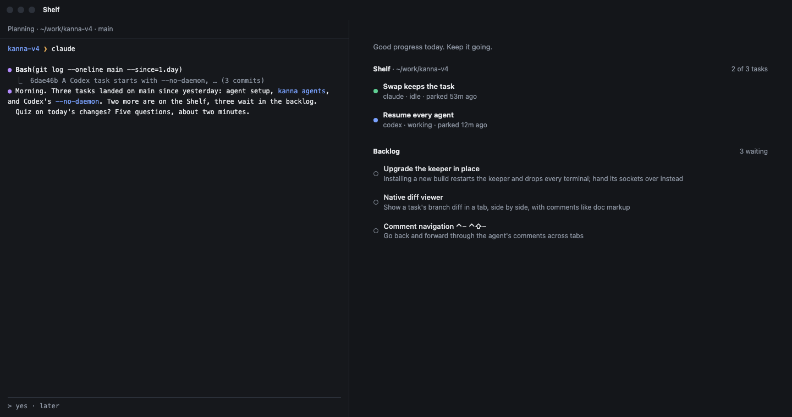
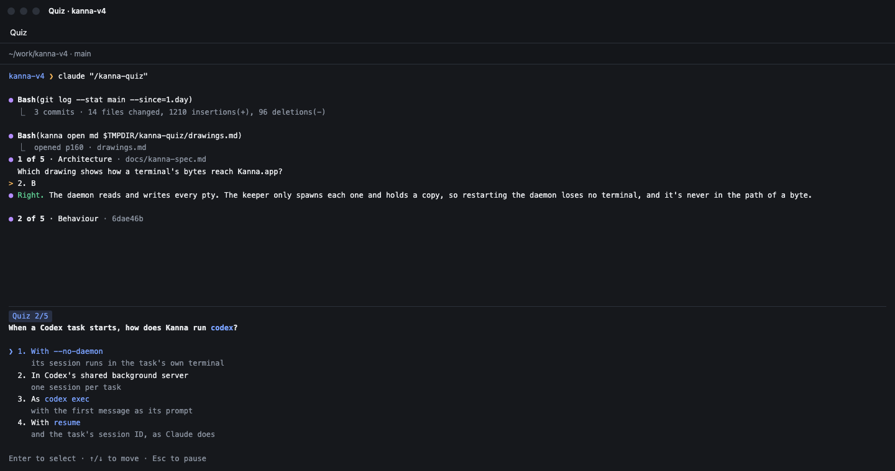
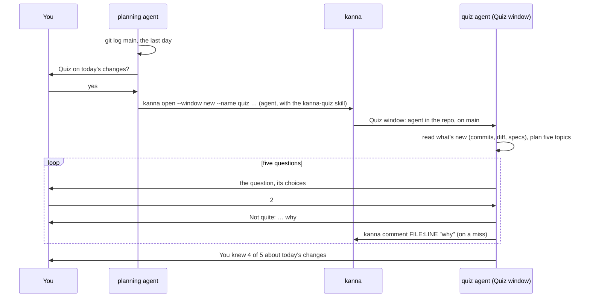
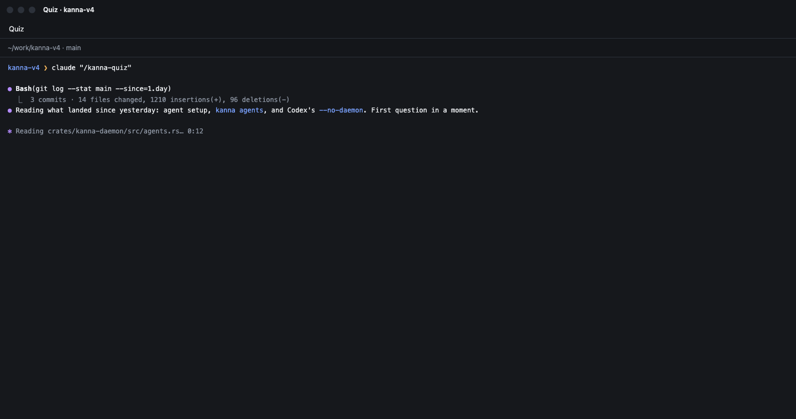
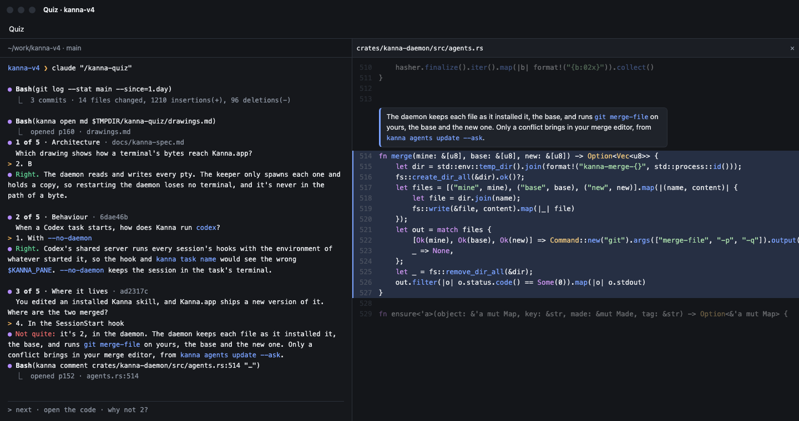
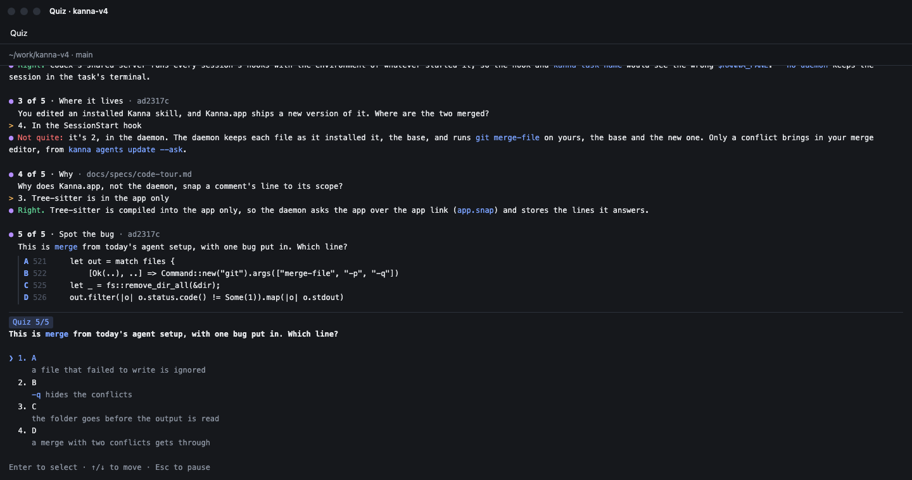
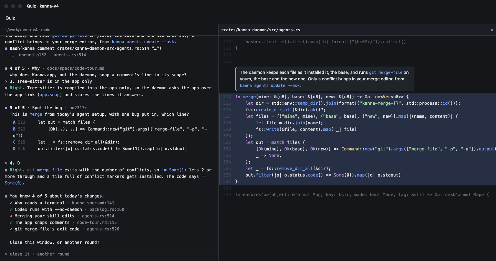
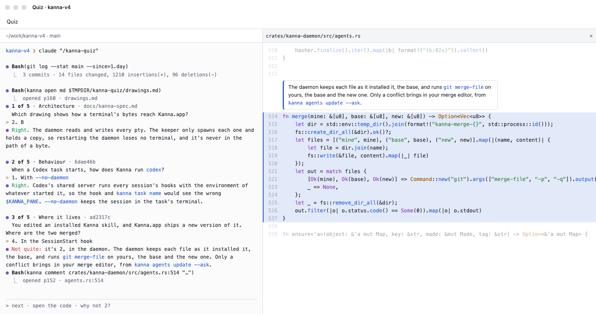
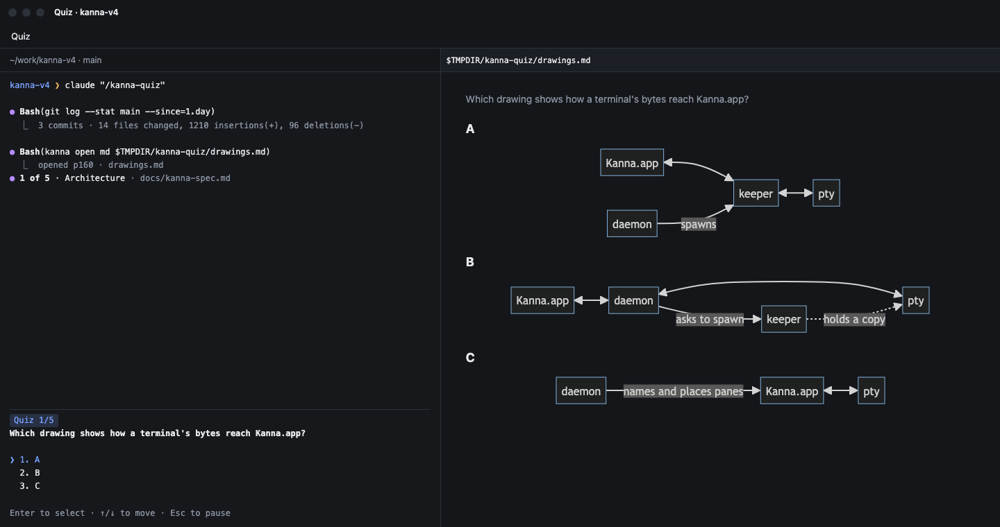
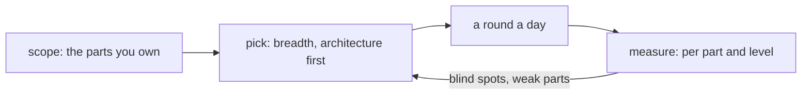

# Quiz

**Status:** planned · **Mockup:** [`references/mockups/quiz.html`](../../references/mockups/quiz.html) · **Builds on:** [code tour](code-tour.md), [planning agent](planning-agent.md), [agent setup](agent-setup.md)

Agents write code faster than you can read it, and you lose track of how your own codebase works. The **quiz** is a short break between reading agent output that keeps you up with what they built: five multiple-choice questions about what landed on main in the last day, asked by an agent in its chat, each answer explained, with the code opened at the line. It's the same problem the `kanna-explain` skill addresses, from the other side: you're asked, rather than told.

It's a skill, `kanna-quiz`, and nothing else: the agent writes the questions itself when you start, and uses the `kanna` commands that already exist to open its window and the code.

**Done when** the planning agent offers a round on this repo's recent changes, and the agent in the Quiz window plays it as in the mockup, in light and dark.

## Contents

1. [A round](#1-a-round)
2. [Rules](#2-rules)
3. [Questions](#3-questions)
4. [The skill](#4-the-skill)
5. [Later: keeping you fluent](#5-later-keeping-you-fluent)
6. [Rejected](#6-rejected)
7. [Glossary](#7-glossary)

## 1. A round

## 2. Rules

- **The planning agent offers, the quiz agent asks.** The planning agent checks what's merged into main in the last day when its session starts, and offers a round once per session if anything has. It never asks the questions itself.
- **The Quiz window** is a plain window, not a Desk, with an agent running in the repo's own folder on main, started with the skill. What it opens (`kanna open`, `kanna comment`, with no placement) splits beside it in that window, wherever you are. There's no task and no worktree, since a quiz changes nothing, and it takes no place on the Shelf. If a pane named `quiz` is already open, the planning agent brings it forward (`kanna focus quiz`) instead of opening another.
- **Written when you start,** by the quiz agent, from what's on main: no background agent, nothing runs between quizzes. It asks the first question as soon as it's written, and writes each next one while you read the explanation.
- **A round is five questions, one at a time,** about two minutes once started. The quiz agent asks each with its multiple-choice tool: Claude's question tool, or a numbered list for an agent without one.
- **Every answer gets a short explanation** and an offer to open the code. **A miss opens it straight away:** `kanna comment FILE:LINE "why"`, so the code shows beside the agent with the explanation on its lines ([code tour](code-tour.md)). A comment on the same file reuses that pane; before one on another file, the agent closes the last.
- **Pausing is leaving.** Close the window or go back to your Desk.
- **Nothing is kept** between rounds: no file, no history. Each round is about the last day on main. Remembering answers, so misses come back, waits for a database ([5](#5-later-keeping-you-fluent)).
- **Nothing interrupts a round.** A task that needs you shows on the Shelf in your Desk window, as always; the quiz doesn't stop for it.
- **No score to protect.** No streaks, no totals over time: the end of a round says what you knew of *these* changes ("You knew 4 of 5 about today's changes").
- **Light and dark** follow the system, as every pane does.

## 3. Questions

| Kind | Example | Comes from |
|---|---|---|
| **Architecture** | Which process owns a pane's terminal: the app, the daemon, or the CLI? | the code's structure (crates, modules, who calls whom) and the specs' diagrams |
| **Pick the drawing** | Which drawing shows how a terminal's bytes reach Kanna.app? | the same as architecture, drawn three ways, two of them wrong |
| **Behaviour** | When you Move to Backlog, what happens to the agent? | the code and commit messages |
| **Where it lives** | Which file decides a pane's status? | the code |
| **Why** | Why does an instance have its own daemon? | the specs and docs |
| **Spot the bug** | Which of these lines from today's merge has a bug put in? | a few lines from recently merged code, one changed |

- **Only what's true on main:** the code at main's commit, the specs and docs there, and the messages of the commits in the last day. Never an agent's conversation.
- **What's new:** main's commits in the last day, at most 30; with none, the agent says so and offers the last 30 commits instead.
- **Architecture questions** ask how the pieces fit: which process or module owns something, how data flows between them, what talks to what, about what today's changes touched, seen from above.
- **Pick-the-drawing questions** have three diagrams for choices. The agent writes them as mermaid diagrams, headed A, B and C, in one markdown file (`$TMPDIR/kanna-quiz/drawings.md`) and opens it beside it (`kanna open md FILE`); you pick A, B or C. It closes that pane when it moves on.

- **Each question is about some lines,** a file and a line range on main: what the agent opens on a miss. An architecture question's lines are where the answer is plainest: a spec's diagram, or the code where one piece hands off to another.
- **A round:** the broader questions first (architecture before a line's detail), spread across files.

## 4. The skill

`kanna-quiz`, in `.agents/kanna-skills`, installed by [agent setup](agent-setup.md) like the others. It has two parts.

**Offering** (the planning agent, which the `kanna-planning` skill sends here):

- `git log main --since=1.day`. With nothing new, say nothing.
- Otherwise offer once, in a line: what landed, and "Quiz on today's changes? Five questions, about two minutes."
- On yes: `kanna focus quiz` if it's open, else `kanna open --window new --name quiz --cwd REPO --cmd 'AGENT "/kanna-quiz"'`, with the agent you are (Claude or Codex).

**Asking** (the quiz agent):

- **Read before asking:** the commit messages and diff of the last day, and the specs they touch; pick five topics, broadest first.
- **One question at a time,** written just before you ask it: four choices (three for a drawing), one right, the wrong ones plausible. Read the lines you'll point to, so the line numbers are right.
- **Never hint,** and never reword the choices once asked.
- **Answer:** right or not in one word, then why, in a sentence or two. On a miss, `kanna comment FILE:LINE "why"`; on a right answer, offer to open the code.
- **Follow questions** between questions, from the code, briefly; then go on.
- **At the end,** say what you knew of the five, and ask whether to close the window or play another round.

## 5. Later: keeping you fluent

Taken further, the quiz becomes a control loop whose goal is that you stay fluent in the code you're responsible for, not just what merged today.

- **Scope:** work out which parts of the codebase you're responsible for (asked once, then from what you review and merge).
- **A round a day**, across those parts, at every level from the architecture down to a line's detail, so code literacy doesn't fade.
- **Remember answers** in a database: every answer with its topic, level and file, so misses come back in a later round (asked fresh, choices shuffled) and a quiz covers what's new since the last one.
- **Measure** how well you know each part at each level, from those answers.
- **Adapt:** steer towards blind spots and parts you keep missing, while keeping breadth, and aiming for the higher levels first.

## 6. Rejected

- **A quiz pane** (its own pane type, with buttons): the quiz is a conversation, and the agent can answer your follow-up questions; a pane can't.
- **An offer on the Desk page:** the planning agent offers it in its chat.
- **A quiz task:** a quiz changes nothing, so it needs no worktree, branch or place on the Shelf.
- **Docking the quiz agent:** a docked pane is a task in Kanna, counted against the project's three; the agent is the window's only tab pane instead, and what it opens splits beside it.
- **Stepping aside when a task needs you:** the Shelf already shows it; the quiz never interrupts.
- **Preparing questions in the background after main moves:** it costs agent runs for quizzes you never take, and needs something watching every repo.
- **A `kanna quiz` command, with a store and a separate question writer in the daemon:** it only kept the answers from the quiz agent, which doesn't matter; the skill and the commands Kanna already has do it all.

## 7. Glossary

| Term | Meaning |
|---|---|
| **Round** | Five questions, asked one at a time, ending with what you knew |
| **Quiz window** | The plain window the planning agent opens: an agent on main, and the code it opens |
| **Quiz agent** | The agent in the Quiz window, running the `kanna-quiz` skill |
| **Level** | How broad a question is: architecture, module, or a line's detail |
