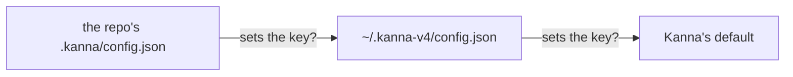

# Settings

**Status:** built · **Builds on:** [planning terminal](planning-agent.md) · **Tests:** `crates/kanna-daemon/src/backlog.rs` (unit), `scripts/e2e-kanna.sh` S45, S46

Kanna's own settings, in two JSON files: yours, and a repo's override. For now there's one setting, how big a planning agent's context gets.

## Contents

1. [Where they live](#1-where-they-live)
2. [Keys](#2-keys)
3. [How it's built](#3-how-its-built)
4. [Rejected](#4-rejected)
5. [Glossary](#5-glossary)

## 1. Where they live



- **Yours:** `~/.kanna-v4/config.json`.
- **A repo's:** `.kanna/config.json` at the repo's root, beside its other Kanna files. It wins over yours, key by key: a key it doesn't set comes from yours, then from Kanna's default.
- **Read when they're used,** not watched: a change applies to the next thing that reads it (for `planning.context`, the next planning terminal).
- **A bad value is ignored** for the next file down, and the daemon's log says which file and key.

```json
{ "planning": { "context": 300000 } }
```

## 2. Keys

| Key | Default | Does |
|---|---|---|
| `planning.context` | `300000` | Tokens a claude agent's context grows to in a [planning terminal](planning-agent.md) before it compacts, from 100000 to 1000000, or `"auto"` for claude's own. A long-lived agent works better kept small (context rot). The terminal sets `CLAUDE_CODE_AUTO_COMPACT_WINDOW`, unless your environment already does. Other agents keep their own limit (codex's is already shorter); each gets this setting as Kanna supports it. |

## 3. How it's built

- **The daemon reads them** when it needs a setting, for a folder: the repo of that folder's `.kanna/config.json`, then `~/.kanna-v4/config.json` (each at most 64 KB).
- **`planning.context`** is read as the daemon builds a planning terminal's command, for the folder it opens in, and becomes an `export` in that command.

## 4. Rejected

- **`~/.config/kanna/`:** `~/.kanna-v4/` and a repo's `.kanna/` keep Kanna's files together, with a repo override beside the repo's other Kanna files.
- **One file per feature** (`planning.json`): one `config.json` with a section per feature has room for the settings to come.
- **Passing claude `--autocompact`:** Kanna doesn't start the planning agent; an environment variable in its terminal reaches whatever claude you start there.

## 5. Glossary

| Term | Meaning |
|---|---|
| **Compact** | An agent summarising its conversation to shrink its context, keeping what matters |
| **Context rot** | A long conversation's older turns crowding out what matters, so the agent works worse |
