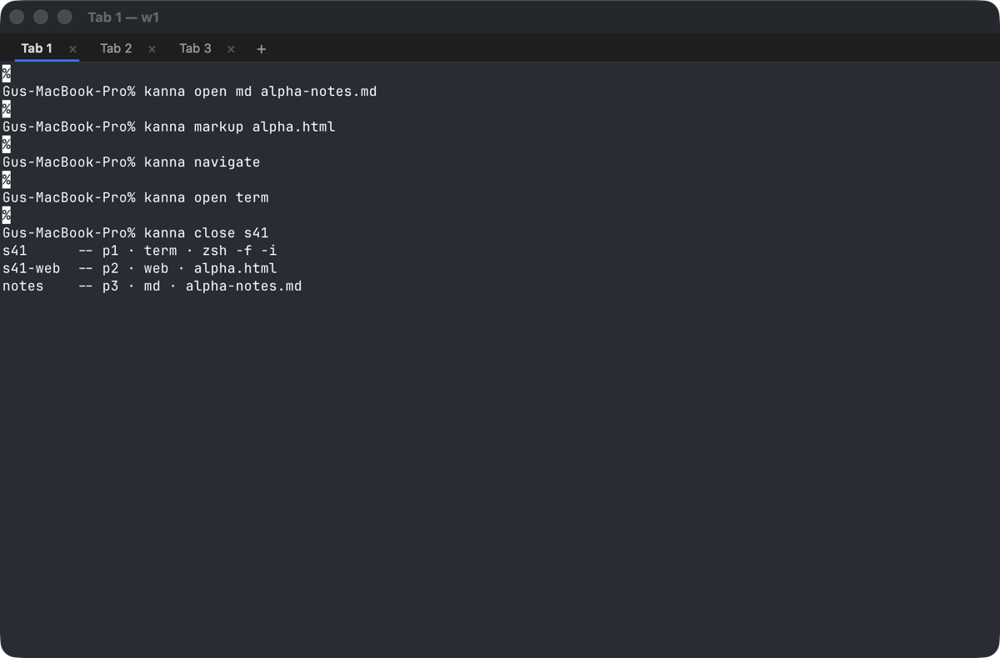
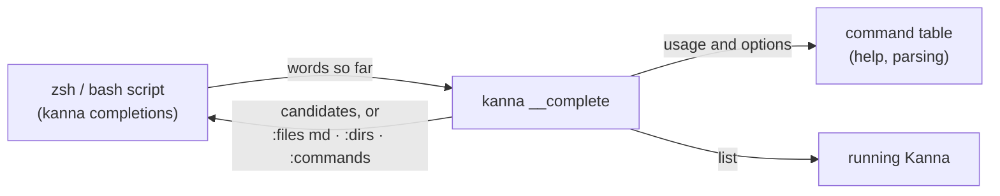
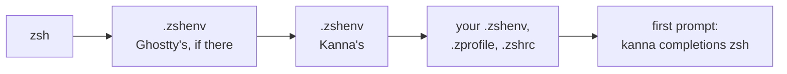

# Tab Completion

**Status:** built

Tab completes `kanna` commands the way you'd hope: the command, its options, the values they take, the pane, tab or window you mean, and only the files that make sense.

## Contents

1. [Turning it on](#1-turning-it-on)
2. [What completes](#2-what-completes)
3. [Rules](#3-rules)
4. [How it's built](#4-how-its-built)
5. [Glossary](#5-glossary)

## 1. Turning it on

**In Kanna's terminals it's on**, for zsh: nothing to add. Elsewhere, or for bash:

| Shell | Add to | Line |
|---|---|---|
| zsh | `~/.zshrc` | `source <(kanna completions zsh)` |
| bash | `~/.bashrc` | `eval "$(kanna completions bash)"` |

## 2. What completes

| You type | Tab offers |
|---|---|
| `kanna ` | every command, with its summary, then `help`, `commands`, `instances`, `raw`, `completions` |
| `kanna open ` | `term`, `web`, `md`, `ios`, each with what it opens |
| `kanna open md ` | markdown files (`.md`, `.markdown`, `.mdown`) and folders |
| `kanna open web `, `kanna markup ` | HTML files and folders |
| `kanna close `, `focus`, `send`, `read`, `zoom`, … | panes: a name, or the ID of a pane without one, with its ID, type and what it shows |
| `--tab `, `rename-tab `, `move-tab ` | tabs, with their title and window |
| `--window ` | `new` and the windows |
| `--split `, `--dock `, `--side `, `--mux ` | their values |
| `--size `, `resize PANE ` | `1/2`, `1/3`, `2/3`, `1/4`, `3/4` |
| `--cwd ` | folders |
| `--cmd ` | commands on your PATH |
| `--app ` | `.app` bundles; `--device `: the simulators, booted ones marked |
| `--instance ` | the running instances |
| `-` | the command's options, then the global ones, each with its help |

## 3. Rules

- **Never starts anything.** Pane, tab and window names come from the Kanna that the command would go to (`--instance`, `--mux`, `$KANNA_SOCKET`), only if it's already running.
- **IDs on request.** A named pane is offered by name; type `p` and a digit to get IDs instead.
- **After `--`** nothing is completed: it's text.
- **Order is the help's order**, not alphabetical.
- **Your startup files still run**, in the usual order, with your own `ZDOTDIR` if you set one. Kanna only adds the completion after they've run, at the first prompt; if your `~/.zshrc` loads it too, nothing changes.

## 4. How it's built

In Kanna's terminals the daemon starts zsh with `ZDOTDIR` pointing at a `.zshenv` of its own, in its state folder (`shell/zsh`), the way Ghostty's shell integration does; with Ghostty's integration in front, Ghostty's `.zshenv` hands over to Kanna's.

The shell script only asks and shows. `kanna __complete -- WORDS…` reads the command table that help and parsing use: the usage lines give the positional words (`open md FILE`), the options give their values (`--split right|down|auto`, `--window ID|new`). It prints one candidate a line, `value⇥description`, or asks the shell for files of some kinds, folders or commands. If zsh's completion system isn't loaded, the zsh script loads it.

## 5. Glossary

| Term | Meaning |
|---|---|
| Candidate | One thing Tab can put in: a word with an optional description |
| Placeholder | An upper-case word in a usage line (`PANE`, `FILE`, `WINDOW`) that names the kind of value |
