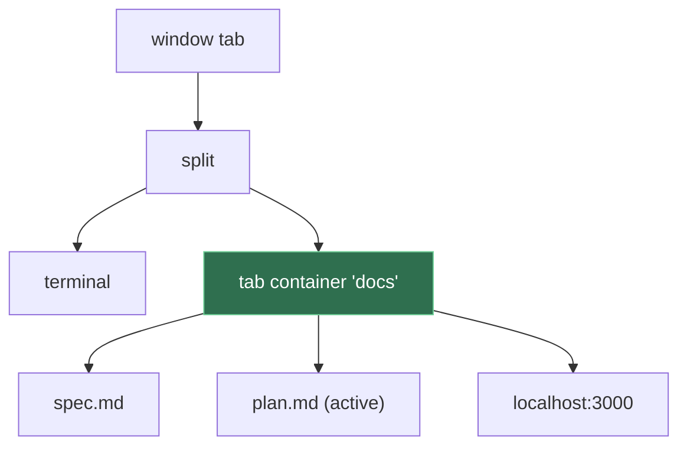

# Tab Container

**Status:** proposed · **Mockup:** [`docs/mockups/tab-container.html`](../mockups/tab-container.html)

A **tab container** is a slot in a split that holds several panes as tabs and shows one at a time. Example: your markdown docs share the right half of the window as tabs, beside a terminal.

## Contents

1. [The idea](#1-the-idea)
2. [Rules](#2-rules)
3. [Using it](#3-using-it)
4. [CLI](#4-cli)
5. [How it's built](#5-how-its-built)
6. [Open questions](#6-open-questions)
7. [Glossary](#7-glossary)

## 1. The idea

Today a window tab holds a tree of splits, and every leaf is a pane. A container is a new kind of leaf: it holds a list of panes and shows the active one.

The panes inside stay ordinary panes, with their own IDs, names and processes, so every pane command still works on them. The container is only layout, like a split.

## 2. Rules

- **Panes only:** a container holds panes, not splits or other containers.
- **One active:** one pane is shown; the others keep running.
- **Addressable:** it has an ID (`c1`) and an optional name.
- **Lifetime:** it stays with one tab and goes away with its last.
- **Zoom:** zooming zooms the whole container, strip included.
- **Moving:** it moves between tabs and windows with all its panes.

## 3. Using it

- **The strip:** a thin row of tabs at the top of the slot, darker than the window's tab bar. Each tab shows the pane's icon and title, with × to close; after the tabs come + and the container's name. Too many tabs shrink, then scroll.
- **Click** a tab to show it; **middle-click** or **×** to close it; **+** for a new terminal, file or URL here.
- **Drag** a tab along the strip to reorder; onto a split edge to take it out; onto another strip to move it. Drop any pane on a strip to add it.
- **Keys:** ⌃Tab / ⌃⇧Tab for the next and previous tab; ⌘W closes the active one.
- **Markdown:** ⌘-click a link to another doc to open it as a new tab beside this one. A plain click still navigates in place.

## 4. CLI

| Command | Does |
|---|---|
| `kanna open md a.md --split right --in new --name docs` | Opens a new container with one tab. |
| `kanna open md b.md --in docs` | Adds a tab to `docs`. If `--in` names a plain pane, a container is made around it. |
| `kanna move PANE --in docs` | Moves a pane into the container. |
| `kanna focus docs` | Focuses the container's active tab. |
| `kanna close docs` | Closes the container and its panes. |
| `kanna list` | Shows it as `docs[p2 p3* p4]`, where `*` marks the active tab. |

## 5. How it's built

- **Where it lives:** the container is a node in the layout model the app owns. It's saved in `layout.json`; the daemon doesn't change.
- **In JSON:** a layout writes it as `{"container": "c1", "name": "docs", "active": "p3", "tabs": [{"pane": "p2"}, …]}`.
- **Without the app:** `--in` needs the layout, so it answers `no_app`.
- **kmux:** kmux has no containers, so this is a Kanna addition. kmux's protocol cases must still pass unchanged, and `--mux kmux` answers `--in` with "not supported".
- **Checked by:** an e2e scenario that drives the strip and compares `list` and screenshots with the mockup.

## 6. Open questions

1. Should a container ever hold a split, such as a terminal under a doc as one tab? Proposed: no.
2. Is ⌃Tab right, given some terminal programs use it? The alternative is ⌥⌘] / ⌥⌘[.

## 7. Glossary

| Term | Meaning |
|---|---|
| **Tab container** | A split slot holding panes as tabs, one shown at a time. |
| **Tab strip** | The row of tabs along the top of a container. |
| **Active tab** | The pane the container is showing. |
