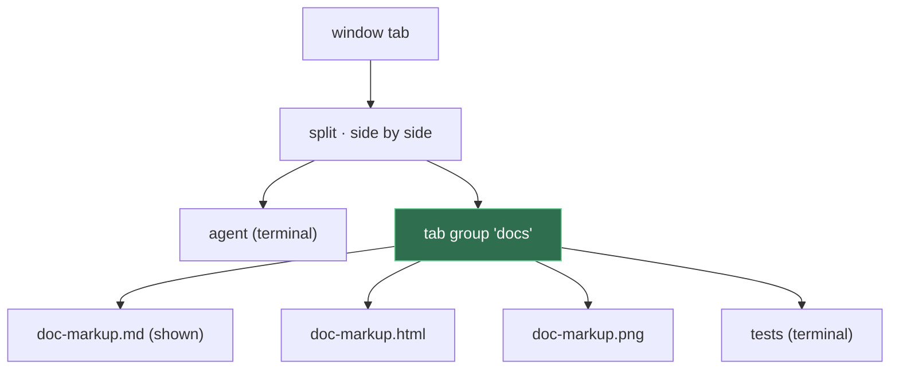

# Tab Groups

**Status:** proposed · **Used by:** [Desk](desk.md) · **Mockup:** the Desk's ([`docs/mockups/desk.html`](../mockups/desk.html)), whose right side is a tab group

A **tab group** is a slot in a split that holds several panes and shows one at a time, with a strip of tabs to switch between them. It's a mux-layer primitive, a kind of layout node like a split, so any window can use it; the Desk is one layout built from it (an agent pane beside a group of docs).


## Contents

1. [The layout tree](#1-the-layout-tree)
2. [Rules](#2-rules)
3. [Keys and mouse](#3-keys-and-mouse)
4. [CLI](#4-cli)
5. [How it's built](#5-how-its-built)
6. [Open questions](#6-open-questions)
7. [Glossary](#7-glossary)

## 1. The layout tree

Today a window tab holds a tree of splits whose leaves are panes. A tab group is a second kind of leaf: it holds a list of panes and which one is shown.



The panes in a group stay ordinary panes, with their own IDs, names and processes, so every pane command (`send`, `read`, `navigate`, `close`, `restart`) works on them unchanged. A group is only layout.

## 2. Rules

- **Panes only:** a group holds panes, not splits or other groups.
- **One shown:** the others keep running; a terminal in a hidden tab keeps its output, as a terminal in a hidden window tab does today.
- **Named:** a group has a name (`docs`), unique in its window tab, so commands can target it.
- **Lifetime:** closing a group's last pane removes the group, and the split closes up as it does for a pane.
- **Focus:** focusing a pane in a group shows it. Next/previous pane move through the split, not through the group's hidden panes.

## 3. Keys and mouse

| Action | Does |
|---|---|
| ⌘1 … ⌘9 | Show the group's 1st … 9th tab (the group with focus, or the Desk's docs) |
| ⌃Tab / ⌃⇧Tab | Next / previous tab in the focused group |
| click a tab | Show it |
| × or middle-click | Close that pane |
| drag a tab | Reorder; drop on another group or split edge to move the pane there |
| + | Open a file, page or terminal into the group |

## 4. CLI

| Command | Does |
|---|---|
| `kanna open … --in GROUP` | Open the pane as a tab of GROUP, shown; makes GROUP beside the focused pane if it doesn't exist |
| `kanna move PANE --in GROUP` | Move an existing pane into GROUP |
| `kanna focus PANE` | Also shows PANE if it's in a group |
| `kanna list` | Shows each group's panes in its layout line: `[spec* mockup tests]` |

In the layout expression ([7.2](../kanna-spec.md#72-the-layout-expression)), `[a b c]` is a group, `*` marks the shown pane, and `NAME=[…]` names it:

```sh
kanna arrange 'agent:2/5 | docs=[spec* mockup tests]'
```

## 5. How it's built

- **`kanna-mux`** gains the node: `Group {name, panes, shown}` beside `Split` and `Pane`, with its layout steps (`group.add`, `group.show`, `group.remove`) sent to the app like split steps. Its protocol cases are Kanna's additions beside kmux's 31, which keep passing unchanged.
- **The app** draws a group as a tab strip above the shown pane's view; hidden panes keep their views (terminals stay attached), placed off screen like a hidden window tab's.
- **Saved** in `layout.json` as a node of its own; a file without groups loads as before.
- **kmux parity:** kmux has no groups, so a window that never uses one looks and behaves exactly as kmux.

## 6. Open questions

1. Should a window tab hold at most one group, or any number?
2. Drag a tab out onto an empty area of the window: a new split, or a new window?

## 7. Glossary

| Term | Meaning |
|---|---|
| **Tab group** | A layout slot holding several panes, showing one, with tabs to switch |
| **Layout node** | One element of a window tab's tree: a split, a pane, or now a group |
| **Shown pane** | The one pane of a group that's on screen |
