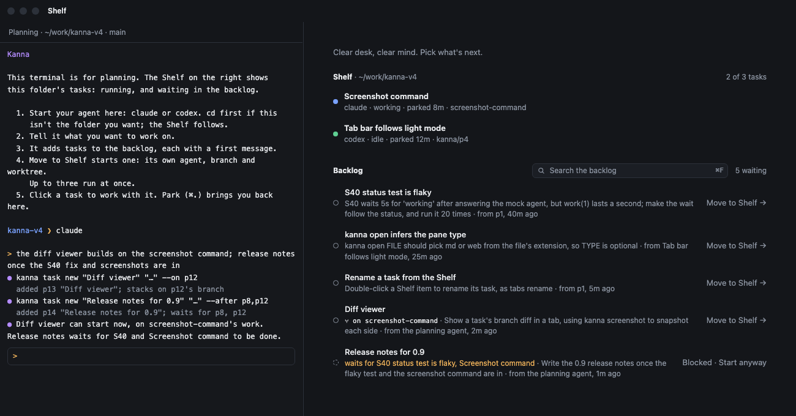
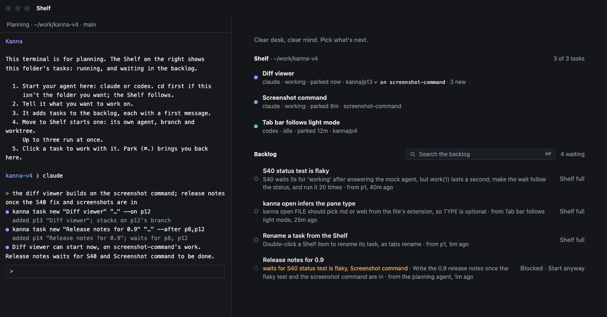
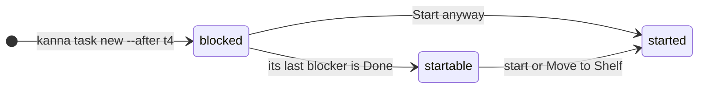
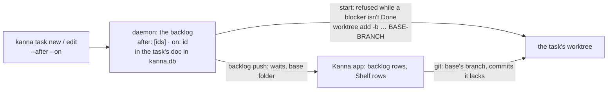

# Blocked and stacked tasks

**Status:** proposed · **Mockup:** [`references/mockups/desk.html`](../../references/mockups/desk.html) (Simulate: stacked tasks; or `#stacked`, `#stacked-started`) · **Builds on:** [tasks](tasks.md), [planning agent](planning-agent.md)

Two separate things for work that builds on other work:

- **Blocked:** a task waits for other tasks and can't start until they're Done.
- **Stacked:** a task starts on a branch made from another task's branch instead of the repo's checkout, like a stacked PR, so it can build on that work before it's merged.

A task can be either, both or neither. Stacking doesn't block: a stacked task can start as soon as its base has a branch.





## Blocked



- **A blocked backlog row** has a dashed ring, an orange line naming what it waits for, and **Blocked · Start anyway** where Move to Shelf usually is. Clicking the row, ↩ in search, `kanna task start` or `kanna task shelve` is refused, and the note says what it waits for.
- **Start anyway** (`--anyway`) starts it now. Blockers only hold back a task's first start: once it has started, they don't matter.
- **Done means Done in Kanna** (`kanna task done`, Done in the app, or its agent's pane closed), not merged. Kanna doesn't watch git for this.
- **When the last blocker is Done, the task becomes startable,** and nothing starts by itself. The row loses its badge, and `kanna task done` says which tasks it freed (`t14 "Release notes for 0.9" can start now`), so the planning agent can offer to start them.
- **A task can't wait for itself,** directly or through others: making that loop is refused.

## Stacked

- **`--on TASK` names the base.** When the task starts, its worktree's new branch is made from the base's branch as it is right then: `git worktree add -b task-… FOLDER BASE-BRANCH`.
- **The base's branch is found through its worktree,** because agents rename their branches. Kanna reads the branch checked out in the base's worktree when the stacked task starts, and again whenever it shows the base.
- **The base must have started,** so it has a branch. Until then the row reads `⑂ on Screenshot command, not started` and starting is refused. A Done base still works while its worktree exists. If the base's worktree is gone, the task starts from the repo's checkout like any other, and says so.
- **Once started, Kanna only reports how the base moves on.** The Shelf row and `kanna task list` show `⑂ on screenshot-command · 3 new`: the base's commits the task doesn't have. When the base is Done, they show `(done)` instead. Kanna never rebases or merges; the task's agent decides, as `kanna-tasks` tells it: rebase onto the base for its new work, or onto main once the base has merged.

## Setting them

Only the planning agent, an agent, or you in a terminal set them, with the CLI. The app shows them and offers Start anyway, but has no form.

```sh
kanna task new "Diff viewer" "…" --on t12
kanna task new "Release notes for 0.9" "…" --after t8,t12
kanna task edit t14 --after t8          # replaces the list; --after none clears it
kanna task edit t13 --on none           # back to the repo's checkout
```

- **TASK** is a task's ID (`t12`) or a running task's pane (`p158`), as `kanna task list` shows them. Kanna stores the task's ID.
- **A blocker must be a task that isn't Done.** A base can be any task Kanna knows, Done ones included.
- **`kanna task edit` changes a backlog task.** Its blockers can change until it first starts; its base can change until it starts, after which its branch is made.

## CLI

| Command | Does |
|---|---|
| `kanna task new NAME [MSG] [--after TASK,…] [--on TASK]` | Make a task that waits for others, stacks on another, or both |
| `kanna task edit TASK [--after TASK,…\|none] [--on TASK\|none]` | Change a backlog task's blockers or base |
| `kanna task start TASK [--anyway]` | Start a task where it is; `--anyway` starts a blocked one |
| `kanna task shelve TASK [--anyway]` | Move a backlog task to the Shelf; `--anyway` starts a blocked one |
| `kanna task list` | STATE is `blocked` for a blocked backlog task, and each task with either gets a last part: `waits for t8, t12` and `on t12 screenshot-command (3 new)` |
| `kanna task done TASK` | Also names the tasks that can start now because of it |

## How it's built



- **Kept in the task's row** in `kanna.db` ([database](database.md)): `after` (a list of task IDs) and `on` (a task ID) in its JSON doc, so no new table or migration. An `edited` event records each change.
- **A blocker is open** while the daemon still has it, in the backlog or running; any other task is Done. So a task freed by Done needs no event: the next backlog push shows it startable.
- **Start and Move to Shelf check blockers first** (error `blocked`, with what it waits for), unless the request says `anyway`. Neither applies to a task that has a worktree already.
- **The base's branch** is `git branch --show-current` in the base's worktree (its `folder`, which a Done task's row keeps), passed to `git worktree add` as the start point. The task records the base's folder as it starts.
- **The backlog push to the app** gives each backlog task its open blockers' IDs and names and its base's name and branch, and each running stacked task its base's folder. The app reads the base's branch and counts the commits the task lacks (`git rev-list --count HEAD..BASE`) with the git it already runs for a task's branch.
- **`kanna task list`** gets the same from the daemon, which counts with git as it lists. **`kanna task done`** reads the backlog after the task is Done and names the tasks whose last blocker it was.

## Rejected

- **Merged into main as "done":** Kanna would have to watch git, and squash or rebase merges hide it.
- **Starting a freed task by itself:** starting tasks is the user's call, as everywhere else in Kanna.
- **Rebasing a stacked task when its base moves:** it rewrites a branch under a working agent.
- **Stacking implies blocking:** stacking exists so you can build on work before it's merged; waiting for it to be Done is a separate choice, `--after`.
