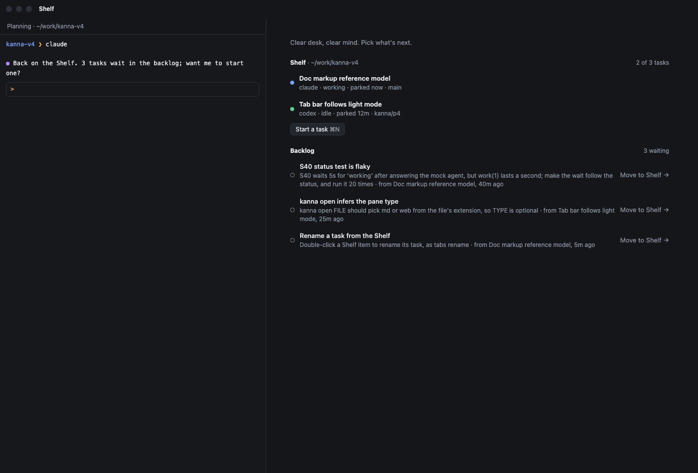
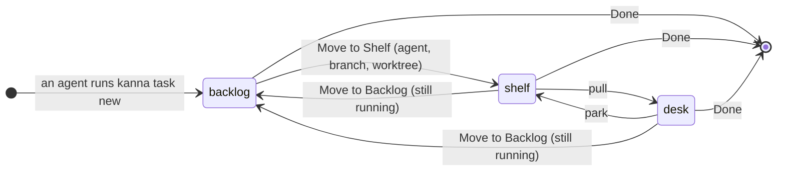
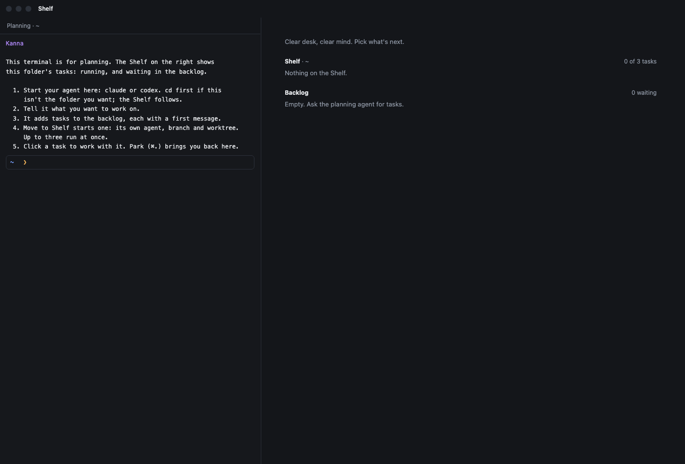
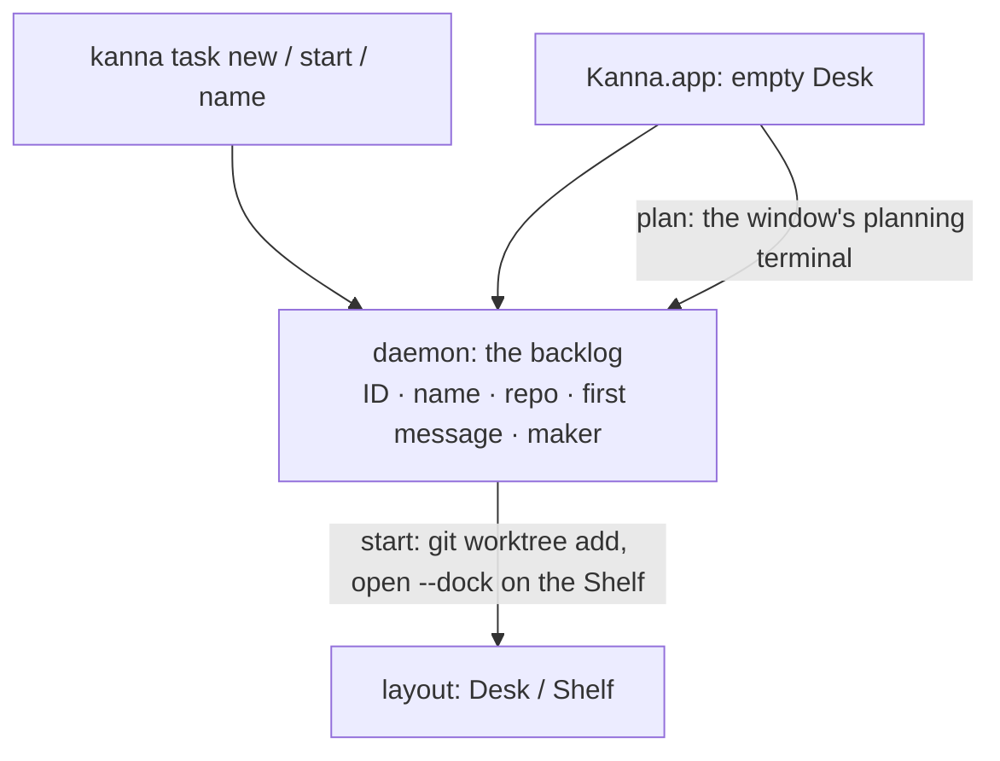

# Tasks

**Status:** built · **Mockup:** [`references/mockups/desk.html`](../../references/mockups/desk.html) (Simulate: no tasks; park to see the backlog; `kanna task new` in an agent's pane) · **Builds on:** [Desk](desk.md) · **From:** Kanna v2's tasks (a worktree per task) and v3's (a task belongs to a repo, and waits until it's pulled)

A **task** is one agent's work in one repo. Agents make tasks: they add them to the repo's **backlog**, and you move the ones you want to the Shelf, where each gets its own agent, branch and worktree. There's no form: you tell the window's [planning agent](planning-agent.md) what you want, and it makes the tasks.

## Contents

1. [What a task is](#1-what-a-task-is)
2. [How tasks are made](#2-how-tasks-are-made)
3. [The backlog](#3-the-backlog)
4. [Naming](#4-naming)
5. [Done](#5-done)
6. [CLI](#6-cli)
7. [How it's built](#7-how-its-built)
8. [Open questions](#8-open-questions)
9. [Glossary](#9-glossary)

## 1. What a task is

- **One repo.** A task belongs to the repo it was made in, so it can later be sent to another machine or person with that repo.
- **A name and a first message.** In the backlog, that's all a task is.
- **On the Shelf, it runs:** its own worktree `<repo>/.kanna-worktrees/<NAME>` on branch `<NAME>`, made from the repo's checked-out commit, and an agent there that gets the first message. NAME is `task-` and the first 32 bits of a fresh random UUID in hex (`task-3f9a1c2e`), so it never collides with another worktree or branch; the agent renames the branch once it knows the work ([4](#4-naming)).
- **Every task works in a worktree.** All development happens in one, never in the repo's own checkout.
- **Kanna is git-based: a task needs a git repo.** In a folder that isn't one, making a task is refused; Kanna never runs `git init` itself. An agent sets the repo up with you (in a new, empty project, the planning agent does), and a repo with no commits yet works: its first task's branch starts empty (`git worktree add --orphan`), so the task's first commit is the project's. Kanna never commits for you.
- **At most three run per repo**: the one on the Desk and two on the Shelf. The backlog has no limit, and a task moved back there still running doesn't count.

## 2. How tasks are made

- **By an agent:** `kanna task new "NAME" "FIRST MESSAGE"` adds a task to the backlog of the repo it runs in. The **planning agent**, the one you start in a window's [planning terminal](planning-agent.md) (`$KANNA_PLANNER` is set there), makes them as you plan with it, and a task's agent splitting off its own work does too.
- **By you, by hand:** the same `kanna task new` in the repo, in any terminal.
- **Only these two.** The app never starts a blank task: every task is made with the CLI or by an agent, and started from the backlog (Move to Shelf, or `kanna task start`). There's no Start a task button or menu item.
- **A window with nothing in it** starts on the Shelf with its planning terminal (pictured above): in the folder Kanna was started in when Kanna opens with nothing, and in your home folder for File → New Desk. It prints how to start ([`getting-started.md`](../../apps/kanna/Resources/getting-started.md)); you start your agent there.
- **File → New Desk (⌘N) opens a Desk for another project:** a new Desk window in the same Kanna, with nothing docked and its planning terminal in `~`, as `kanna ~` would. `cd` it into the project and the Shelf follows; then start your agent. There's no folder picker, and the title bar says Shelf as on any empty Desk. ⌘N always means New Desk; New Window (a plain terminal window) keeps its menu item, without a shortcut.

  
- **No New Instance.** kmux's Kanna → New Instance (a whole second Kanna with its own daemon, keeper and state) isn't in Kanna's menu: working on another project is what a Desk is for. Instances stay as a developer and testing tool (dev builds, `kanna --instance`), not a user feature ([build channels](build-channels.md)).
- **`kanna PATH` opens a Desk on a project:** a new window on the project PATH is in, with nothing docked: its planning terminal (in PATH) beside the project's Shelf and backlog, taking none of its three running slots. The window keeps the project across a relaunch, until a task from another project is pulled onto it.
- **A new or empty project** (an empty folder, or not a git repo yet): the planning agent helps you decide what it is, sets it up (`git init` and a first commit only when you agree), and turns the plan into backlog tasks, with Kanna's `kanna-new-project` skill.

## 3. The backlog

- **The empty Desk lists it** under the Shelf: each task's name, its first message, and the task that made it.
- **Move to Shelf** starts a task: it makes the worktree, starts the agent with the first message, and puts it on the Shelf. When three already run, it's refused until one is Done.
- **Oldest first.** A Desk's Shelf strip shows how many wait.
- **Search it** with ⌘F on an empty Desk, by name or first message: [backlog search](backlog-search.md).

## 4. Naming

- **The agent names its task** with `kanna task name "NAME"` once it knows what the work is. Until then it shows its agent's terminal title as is, status glyph and all (`◑ Claude Code`), or "New task" when there isn't one.
- **It learns how from Kanna's `kanna-tasks` skill** ([`.agents/kanna-skills/skills/kanna-tasks`](../../.agents/kanna-skills/skills/kanna-tasks/SKILL.md)), which also tells it to write backlog first messages that stand alone and to leave starting tasks to you. The planning agent has its own, keyed on `$KANNA_PLANNER`: [`kanna-planning`](../../.agents/kanna-skills/skills/kanna-planning/SKILL.md) (say what's running and waiting, plan with you, make backlog tasks, start or end them only when you ask, never write code), and [`kanna-new-project`](../../.agents/kanna-skills/skills/kanna-new-project/SKILL.md) for a folder that's empty or not a repo yet (decide what it's for, `git init` and a first commit only when you agree, then the first tasks).
- **A backlog task's name** is the one its maker gave it, kept when it starts.
- **The agent renames its branch** too, with `git branch -m NEW` in its worktree, from `task-3f9a1c2e` to a short name for the work. The worktree's folder keeps its name: the agent and its terminals are in it.

## 5. Done, or back to the backlog

- **Done ends the task:** its agent and tabs close, or it leaves the backlog.
- **The worktree and branch stay.** Cleaning them up is yours for now.
- **Move to Backlog puts a running task back** (Task menu, or `kanna task defer`), freeing its slot of the three: it leaves its Desk or the Shelf and waits in the backlog again, under its old ID if Kanna started it.
- **It keeps running there.** Its agent carries on with whatever it was doing, and its tabs stay as they were; the backlog lists it like any other task.
- **Starting it again brings it back as it is:** the same agent and tabs, on the Shelf, with no restart.
- **If its agent's pane closed meanwhile,** starting it opens a new agent in its worktree (a new worktree only if that's gone too), and a claude agent comes back to its conversation: Kanna starts claude with a session ID of its own (`claude --session-id UUID`), keeps it with the task, and resumes it (`claude --resume UUID`). A claude task Kanna didn't start resumes the folder's latest conversation (`claude --continue`). Other agents start again with the first message, their conversation lost, until they resume too ([open questions](#8-open-questions)).
- **Done on a backlog task that's still running** ends its agent and tabs too.

## 6. CLI

| Command | Does |
|---|---|
| `kanna task new NAME [FIRST-MESSAGE] [--agent CMD]` | Add a task to this repo's backlog (the agent defaults to `$KANNA_AGENT`, else `claude`, and starts without asking permission) |
| `kanna task start TASK [--window WINDOW]` | Move a backlog task to the Shelf (or onto that Desk): worktree, agent, first message |
| `kanna task name [TASK] NAME` | Name a task (default: the one you're in) |
| `kanna task list [QUERY]` | Every task: ID, where (a Desk, the Shelf, the backlog), status, repo, name; with QUERY, only those whose name or first message has every word ([backlog search](backlog-search.md#cli)) |
| `kanna task defer [TASK]` | Move a running task back to the backlog, still running, until it's started again (default: the one you're in) |
| `kanna task done [TASK]` | End a task, or take it off the backlog |

`park` and `pull` are the [Desk's](desk.md#5-cli).

## 7. How it's built

- **The daemon keeps the backlog**, saved with the terminals, so agents add tasks with or without the app.
- **The daemon opens planning terminals** (`backlog` `plan`): it makes the command (`KANNA_PLANNER`, the context limit, the getting-started text, then your shell) and opens it as the window's planner in its folder ([planning agent](planning-agent.md#7-how-its-built)).
- **A running task is its docked agent pane**, as on the [Desk](desk.md): its name is the pane's name, its repo the pane's folder.
- **Only a task's agent docks.** `kanna move PANE --dock` moves the docked pane to the other edge or another window, and refuses any other pane (`not_a_task`), so a task starts only by starting one and the limit holds.
- **A task moved to the backlog is parked, not closed:** the layout keeps its window (agent docked, tabs) with the Shelf's, marked as in the backlog and saved with the rest, so its panes keep running and survive a relaunch; the Shelf, the limit and `pull` skip it. Its backlog entry names its agent's pane, and starting it clears the mark.
- **Starting** a backlog task checks the limit, runs `git worktree add`, opens the agent docked straight onto the Shelf in that folder with the first message, names the pane, and drops the backlog entry.
- **An ID is never handed out twice.** A new task's ID is saved as it's made, so a restart can't reuse one. IDs name backlog entries only; worktrees and branches get their own random names, so a lost `backlog.json` or another Kanna on the same repo can't collide with them.
- **A task's agent doesn't ask permission.** Starting one adds the agent's own flag for that (`claude --dangerously-skip-permissions`, `codex --yolo`) unless its command already says how to ask (`--permission-mode`, `--ask-for-approval`/`-a`). The task works in its own worktree, and you watch it on the Desk. The backlog keeps the command as written.

## 8. Open questions

1. **Task IDs that travel:** backlog IDs (`t4`) are this machine's; sending tasks elsewhere will want IDs that don't clash.
2. **Resuming every agent:** only claude comes back to its conversation when its agent's pane closed in the backlog; codex and the others need their own session IDs and resume (backlog task t15).

## 9. Glossary

| Term | Meaning |
|---|---|
| **Task** | One agent's work in one repo, shown on a Desk |
| **Backlog** | A repo's tasks waiting to be moved to the Shelf: a name and a first message each, and the agent of one moved back still running |
| **Repo** | The git repository a task belongs to |
| **Worktree** | A second checkout of the repo, in `.kanna-worktrees/`, on the task's own branch |
| **First message** | What the agent is told when its task starts |
