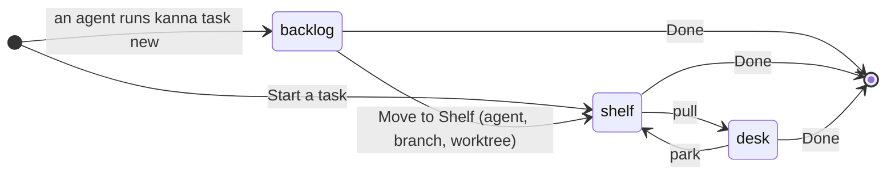
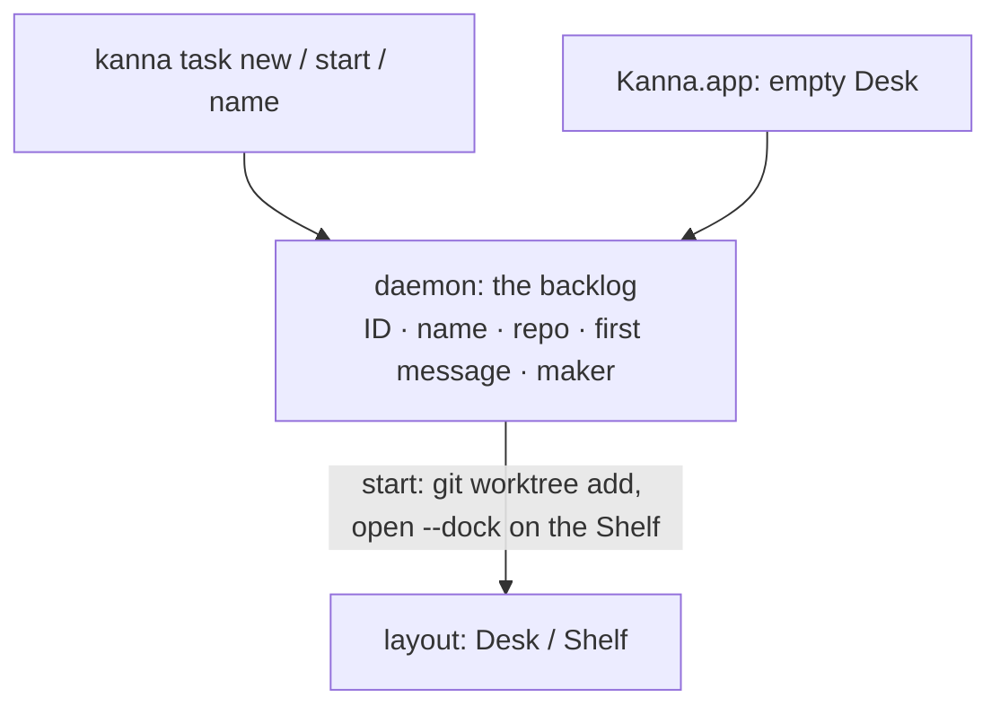

# Tasks

**Status:** built · **Mockup:** [`references/mockups/desk.html`](../../references/mockups/desk.html) (Simulate: no tasks; park to see the backlog; `kanna task new` in an agent's pane) · **Builds on:** [Desk](desk.md) · **From:** Kanna v2's tasks (a worktree per task) and v3's (a task belongs to a repo, and waits until it's pulled)

A **task** is one agent's work in one repo. Agents make tasks: they add them to the repo's **backlog**, and you move the ones you want to the Shelf, where each gets its own agent, branch and worktree. There's no form: a repo with no tasks starts you on a terminal where you run your agent and tell it what you want.

## Contents

1. [What a task is](#1-what-a-task-is)
2. [How tasks are made](#2-how-tasks-are-made)
3. [The backlog](#3-the-backlog)
4. [Naming](#4-naming)
5. [Done](#5-done)
6. [CLI](#6-cli)
7. [How it's built](#7-how-its-built)
8. [Open questions](#8-open-questions)
9. [Glossary](#9-glossary)

## 1. What a task is

- **One repo.** A task belongs to the repo it was made in, so it can later be sent to another machine or person with that repo.
- **A name and a first message.** In the backlog, that's all a task is.
- **On the Shelf, it runs:** its own worktree `<repo>/.kanna-worktrees/<ID>` on branch `kanna/<ID>`, made from the repo's checked-out commit, and an agent there that gets the first message. `--no-worktree` makes a task work in the repo itself.
- **At most three run per repo**: the one on the Desk and two on the Shelf. The backlog has no limit.

## 2. How tasks are made

- **By an agent:** `kanna task new "NAME" "FIRST MESSAGE"` adds a task to the backlog of the repo it runs in. An agent planning with you, or one splitting its own work, makes tasks this way.
- **Start a task** (⌘N on a Desk, where it takes over from New Window; or the button on an empty Desk): a new task on this Desk with an agent in its own worktree and no first message. You tell the agent what to do; it names the task.
- **A repo with no tasks** starts on a task with a plain terminal and a Getting started tab (pictured above): when Kanna opens with nothing, and when a Desk empties with no tasks running or waiting. You `cd` to your repo and run your agent there; the Desk follows the terminal's folder.

## 3. The backlog

- **The empty Desk lists it** under the Shelf: each task's name, its first message, and the task that made it.
- **Move to Shelf** starts a task: it makes the worktree, starts the agent with the first message, and puts it on the Shelf. When three already run, it's refused until one is Done.
- **Oldest first.** A Desk's Shelf strip shows how many wait.

## 4. Naming

- **The agent names its task** with `kanna task name "NAME"` once it knows what the work is. Until then it shows its agent's terminal title as is, status glyph and all (`◑ Claude Code`), or "New task" when there isn't one.
- **It learns how from Kanna's `kanna-tasks` skill** ([`.agents/kanna-skills/skills/kanna-tasks`](../../.agents/kanna-skills/skills/kanna-tasks/SKILL.md)), which also tells it to write backlog first messages that stand alone and to leave starting tasks to you.
- **A backlog task's name** is the one its maker gave it, kept when it starts.

## 5. Done

- **Done ends the task:** its agent and tabs close, or it leaves the backlog.
- **The worktree and branch stay.** Cleaning them up is yours for now.

## 6. CLI

| Command | Does |
|---|---|
| `kanna task new NAME [FIRST-MESSAGE] [--no-worktree] [--agent CMD]` | Add a task to this repo's backlog (the agent defaults to `$KANNA_AGENT`, else `claude`, and starts without asking permission) |
| `kanna task start TASK [--window WINDOW]` | Move a backlog task to the Shelf (or onto that Desk): worktree, agent, first message |
| `kanna task name [TASK] NAME` | Name a task (default: the one you're in) |
| `kanna task list` | Every task: ID, where (a Desk, the Shelf, the backlog), status, repo, name |
| `kanna task done [TASK]` | End a task, or take it off the backlog |

`park` and `pull` are the [Desk's](desk.md#4-cli).

## 7. How it's built

- **The daemon keeps the backlog**, saved with the terminals, so agents add tasks with or without the app.
- **A running task is its docked agent pane**, as on the [Desk](desk.md): its name is the pane's name, its repo the pane's folder.
- **Only a task's agent docks.** `kanna move PANE --dock` moves the docked pane to the other edge or another window, and refuses any other pane (`not_a_task`), so a task starts only by starting one and the limit holds.
- **Starting** a backlog task checks the limit, runs `git worktree add`, opens the agent docked straight onto the Shelf in that folder with the first message, names the pane, and drops the backlog entry.
- **A task's agent doesn't ask permission.** Starting one adds the agent's own flag for that (`claude --dangerously-skip-permissions`, `codex --yolo`) unless its command already says how to ask (`--permission-mode`, `--ask-for-approval`/`-a`). The task works in its own worktree, and you watch it on the Desk. The backlog keeps the command as written.

## 8. Open questions

1. **Task IDs that travel:** backlog IDs (`t4`) are this machine's; sending tasks elsewhere will want IDs that don't clash.

## 9. Glossary

| Term | Meaning |
|---|---|
| **Task** | One agent's work in one repo, shown on a Desk |
| **Backlog** | A repo's tasks that aren't running yet: a name and a first message each |
| **Repo** | The git repository a task belongs to |
| **Worktree** | A second checkout of the repo, in `.kanna-worktrees/`, on the task's own branch |
| **First message** | What the agent is told when its task starts |
