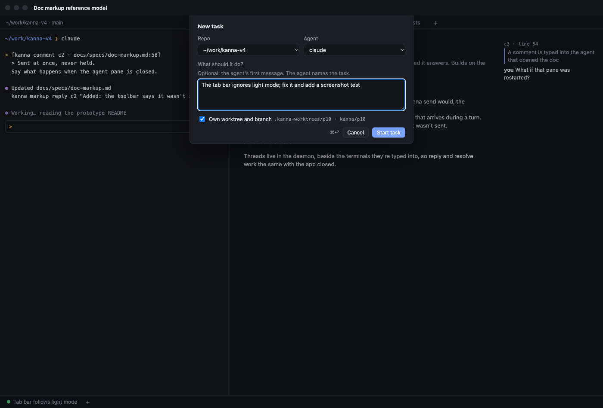
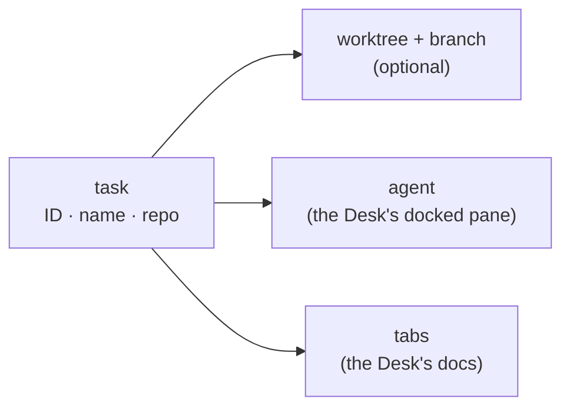
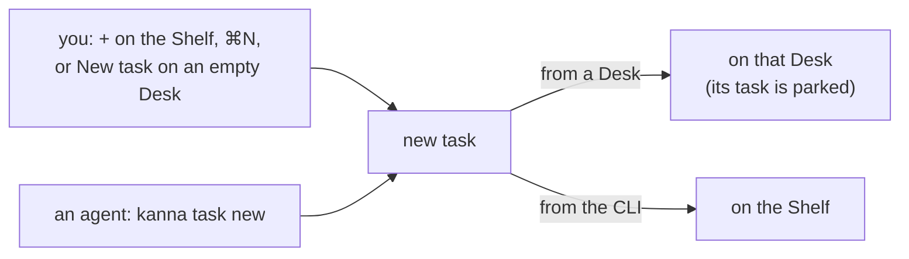
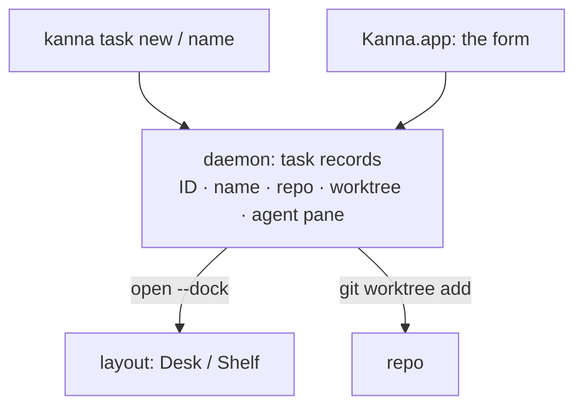

# Tasks

**Status:** proposed · **Mockup:** [`references/mockups/desk.html`](../../references/mockups/desk.html) (+ or ⌘N; `kanna task new` in an agent's pane) · **Builds on:** [Desk](desk.md) · **From:** Kanna v2's tasks (a worktree per task) and v3's (a task belongs to a repo)

A **task** is a piece of work for one agent in one repo: its own worktree and branch by default, an agent working there, and a name the agent gives it. You make one from a Desk, or an agent makes one from its terminal. The [Desk](desk.md) shows it; the Shelf holds the rest.

## Contents

1. [What a task is](#1-what-a-task-is)
2. [Making a task](#2-making-a-task)
3. [Naming](#3-naming)
4. [Done](#4-done)
5. [CLI](#5-cli)
6. [How it's built](#6-how-its-built)
7. [Open questions](#7-open-questions)
8. [Glossary](#8-glossary)

## 1. What a task is

- **One repo.** A task is tied to the repo it was made in, so it can later be sent to another machine or person who has that repo. The repo is also its project: at most three tasks per repo ([Desk](desk.md#3-the-shelf)).
- **Its own worktree and branch, unless you say not to:** `<repo>/.kanna-worktrees/<ID>` on branch `kanna/<ID>`, from the repo's default branch. Without one, the agent works in the repo as it is.
- **An agent:** Claude Code or Codex, started in the task's folder and docked on its Desk. Its first message is the prompt you gave, if any.
- **A name**, which the agent gives it ([3](#3-naming)). Until then it's "New task".

## 2. Making a task

- **From a Desk:** + at the end of the Shelf, ⌘N, or New task on an empty Desk. The form asks for the repo (the Desk's, by default), the agent, an optional first message, and whether to make a worktree (yes, by default). The task starts on this Desk, and the one there is parked.
- **From the CLI:** `kanna task new "PROMPT"`, by you or by an agent breaking up its work. The task starts on the Shelf, so nobody's Desk changes under them. Its repo is the one the command runs in.
- **A fourth task in a repo is refused**, from the form and the CLI alike, until one is Done.

## 3. Naming

- **The agent names its task** with `kanna task name "NAME"`, once it knows what the work is: from the first message, or from your first reply if there was none.
- **You can rename it** with the same command.

## 4. Done

- **Done ends the task:** its agent and tabs close, and it leaves the Shelf.
- **The worktree and branch stay.** Cleaning them up is yours for now (`git worktree remove`, `git branch -d`).

## 5. CLI

| Command | Does |
|---|---|
| `kanna task new [PROMPT] [--repo PATH] [--agent claude\|codex] [--no-worktree]` | Make a task on the Shelf |
| `kanna task name [TASK] NAME` | Name a task (default: the one you're in) |
| `kanna task list` | Every task: ID, where, status, repo, name |

`park`, `pull` and `done` are the [Desk's](desk.md#4-cli).

## 6. How it's built

- **The daemon keeps the tasks**, saved with the terminals, so `kanna task new` and `name` work with or without the app, and a task survives restarts.
- **Making a task** is: check the limit, `git worktree add` (unless `--no-worktree`), open the agent docked in that folder (on the Shelf, or on the asking Desk), send the prompt.
- **The layout keeps where a task is** (a Desk or the Shelf), as it does now.

## 7. Open questions

1. **Task IDs:** today a task's ID is its agent pane's (p4). A task that moves between machines wants its own (say `t4`, or `<repo>-4`), which also names its branch.
2. **How the agent learns to name its task:** a line Kanna adds to the first message, or Kanna's agent skill.
3. **Which commit a worktree starts from:** the default branch, or what the repo has checked out.

## 8. Glossary

| Term | Meaning |
|---|---|
| **Task** | One agent's piece of work in one repo, shown on a Desk |
| **Repo** | The git repository a task belongs to; also its project |
| **Worktree** | A second checkout of the repo, in `.kanna-worktrees/`, on the task's own branch |
| **Prompt** | The first message the agent gets, if you gave one |
