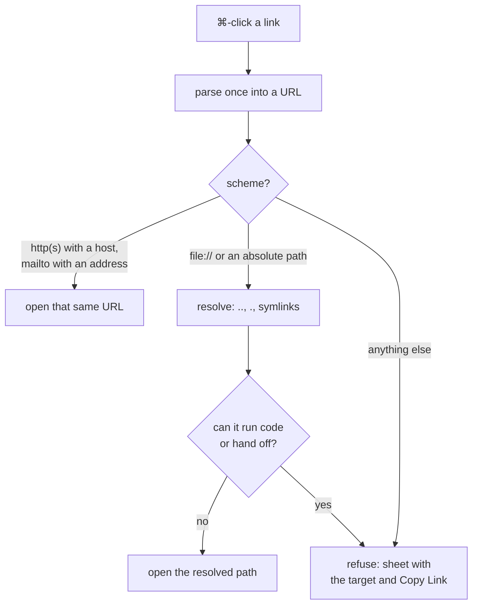

# Terminal Links

**Status:** built · **Part of:** [terminal behaviour](terminal.md) · **Reference:** Ghostty's macOS app's rules for OSC 8 links, made stricter

Links come from terminal output, which any program (or a file being `cat`ed) writes, so a click on one is treated as untrusted. Ghostty opens a link only on a click with ⌘ held; the app then decides, in `KannaLinks` (`UntrustedURL`).

## 1. Rules

| Target | Decision |
|---|---|
| `http`, `https` with a host; `mailto` with an address | opened |
| `file://` (empty host or `localhost`) or a plain absolute path, to a document or plain folder | opened, as the path it resolves to |
| anything that can run code or hand off to another target: an app or any other package or bundle, anything inside one, a script, an executable (by type or by its execute bit), a Finder alias, a symlink to any of these, `.command`, `.tool`, `.terminal`, `.webloc`, `.inetloc`, `.fileloc`, `.shortcut`, `.workflow`, `.pkg`, `.mobileconfig`, `.jar`, `.webarchive` and the rest of the list | refused |
| a document whose default app runs code: a terminal (Terminal, iTerm2, Ghostty, Kanna, …), Script Editor, Automator, Installer, Shortcuts, System Settings, Archive Utility, … | refused |
| any other scheme (`ssh`, `vscode`, `x-apple.systempreferences`, `javascript`, `smb`, …) | refused |
| invisible, control or line-breaking characters (bidi marks, zero-width and other blank characters), a `file://` with another host, a user, a port, a query or a fragment, a relative path, a missing file or a device | refused |

A refusal shows a sheet with the target, as it would resolve, and a Copy Link button.

## 2. How the rules hold

- **What is checked is what is opened.** The text is parsed once into a URL; a web or mail link opens that same URL object, and a file opens as the canonical path the checks were made on, so no second parser can read it differently. Percent-encoding (`run%2Ecommand`), case (`PAYLOAD.APP`) and a trailing `/` are judged after decoding.
- **Every part of the path counts**, not just the last: a file inside an `.app` (or any name with a refused extension) is refused, as Launch Services would treat the bundle.
- **Types and the execute bit as well as names:** the file's content type is checked against application, executable, script, bundle, package, alias, symlink, internet location and web archive, so a misleading name doesn't help.
- **Left:** the check and the open are a moment apart, so a program racing to swap the file between them could still win; the open is of the resolved path, right after the check, on the main thread.
- **Versus Ghostty's app:** it asks before opening other schemes and opens plain-text links (its link regex) with no check; Kanna refuses other schemes and checks plain-text links too, since both are written by the program. The screen file Ghostty's `write_screen_file` action writes (a keybinding, the user's own) opens as Ghostty's app opens it.
- **Checked by** `apps/kanna/Tests/KannaLinksTests` (every rule) and `links_bell_notify` of `scripts/e2e-kanna.sh`.

## 3. Glossary

| Term | Meaning |
|---|---|
| **OSC 8 link** | A hyperlink a program writes into the terminal; its text and target can differ. |
