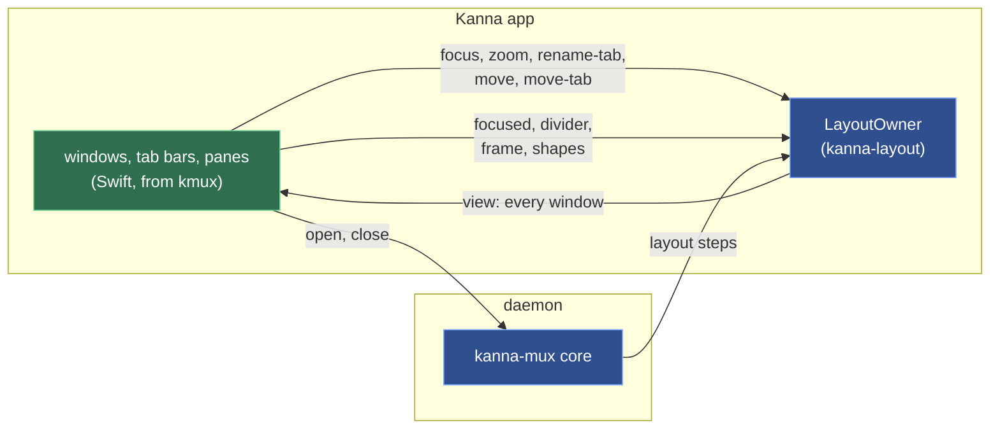
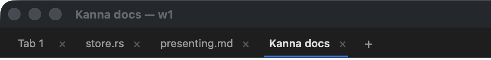

# Windows, Tabs and Splits

**Status:** built ([plan](../plans/mux-build.md) M4, track A) · **Builds on:** [layout](layout.md) · **Reference:** [kmux's spec](https://github.com/tampopogk/kmux/blob/main/docs/kmux-spec.md) §3–§6 · **Related:** [menus](menus.md), [docked pane](docked-pane.md), [zoom](zoom.md)

Kanna.app's windows behave as kmux's: any number of windows, each with a tab bar and the active tab's splits; menus, shortcuts, clicks and drags as kmux's. The views are ported from kmux's app (`WindowController`, `TabBar`, `PaneView`, `Dragging`, `Shortcuts`); what changes is where they get the layout from and where their actions go.

## Contents

1. [Views draw the model; actions go where their state lives](#1-views-draw-the-model-actions-go-where-their-state-lives)
2. [The model's app-only calls](#2-the-models-app-only-calls)
3. [Windows, tabs, panes](#3-windows-tabs-panes)
4. [Tab names](#4-tab-names)
5. [Terminal views](#5-terminal-views)
6. [Debug commands](#6-debug-commands)
7. [Checked by](#7-checked-by)
8. [Glossary](#8-glossary)

## 1. Views draw the model; actions go where their state lives

The views never keep a copy of the layout. After every change the app asks the model for a `view` of every window and draws it. A user action is one of three kinds:

| Kind | Examples | Goes to |
|---|---|---|
| **Layout only** | select, rename, reorder or tear off a tab; focus, zoom, next or previous pane, tab or window; move a pane | the app's own layout model, as the same `command` step the daemon would send (`focus`, `zoom`, `rename-tab`, `move`, `move-tab`) |
| **A pane starts or ends** | Split Right / Down, New Tab, New Window, new web, markdown and iOS panes, Close Pane, × on a tab, Close Window, the red button | the daemon, as a client's request (`open`, `close`), which then sends its layout steps back |
| **What only the app knows** | a click focusing a pane, a divider dragged, a window moved, which panes are wide | the model's app-only calls ([2](#2-the-models-app-only-calls)) |

Layout-only actions skip the daemon because the app is the layout's only writer; a round trip would make every tab click wait on the daemon (and fail while it restarts) for the same answer. Opening and closing go through it because panes are the daemon's: its core gives the IDs, starts and stops terminals, and places the pane through the same steps as a CLI `open`.



```mermaid
sequenceDiagram
    participant U as user
    participant W as window
    participant O as LayoutOwner
    participant D as daemon
    U->>W: ⌘D
    W->>D: open {type: term, split: right, window: w1}
    D->>O: layout {op: place, pane p4, at: right}
    Note over O: shapes first (auto only)
    O->>D: ok {window w1, tab t1}
    Note over W: view → draw w1; p4 attached
    U->>W: ⌘] (next pane)
    W->>O: command focus {pane p1}
    Note over W: view → draw, p1 first responder
    U->>W: drag the divider
    W->>O: divider {tab t1, path [], index 0, share 1/3}
    Note over W: view → draw, saved ½ s later
```

## 2. The model's app-only calls

Through `kanna_layout_call`, besides `serve`, `attach`, `save` and the rest of [layout](layout.md):

| Call | Does | Why it isn't a protocol command |
|---|---|---|
| `view` | `{key, windows: [{id, frame, title, tab, tabs: [{id, title, panes}], focused, zoomed, root, dock}]}`: every window, its tabs and their panes, the tree on screen (the zoomed pane alone when zoomed; nothing when the docked pane is), with exact sizes and pane types, and its docked pane (`{pane, type, edge, width}`, or null) | it's what to draw, not what a client sees (`list` shows names and fractions) |
| `focused {pane}` | a click: the pane's window remembers it as focused (and its tab as last focused), without making the window key or unzooming; answers whether it changed | kmux's app does the same outside its core; `focus` would also make the window key |
| `divider {tab, path, index, share}` | a dragged divider: the two panes either side share what they had, the first getting `share` | `resize` gives one pane a fraction and rescales all its siblings; a divider moves only its two neighbours |
| `frame {window, frame}` | a window moved or was resized; saved with the window | frames are the app's |
| `shapes {panes: {id: wide}}` | which panes on screen are at least as wide as tall; sent before every `place` and `attach` | `auto` splits a wide pane sideways and a tall one down, and only the app knows sizes |
| `resolve {pane}` | a pane name to its ID, for the debug commands | — |

## 3. Windows, tabs, panes


- **Windows:** each window of the model is an `NSWindow` with a `WindowController`. Windows that leave the model close; new ones open cascading from the frontmost; a saved window goes back to its frame if that is still on a screen. The title is the active tab's ([4](#4-tab-names)): `store.rs — w1`. When a window becomes key, it becomes the model's key window (`focus {window}`); when the model's key window changes (a new pane, ⌘\`, `kanna focus`), it's brought forward, or with `--bg` just behind the front app's window. The red button closes the window and its panes. The app stays open with no windows, and the Dock icon then opens a terminal in a new window. Quitting leaves every terminal running.
- **Tabs:** a click selects (a move of 5 pt first starts a drag); a double-click renames (Enter or clicking away saves, Escape cancels; keyboard focus stays in the field while it's open); a drag drops the tab at a gap in any window's tab bar or, outside every window, into a new window there. Right-click: Move Tab to New Window, Close Tab.
- **Panes:** a pane shows a focus outline only in the key window and only with more than one pane in its tab, its exit code (`exited (3)`) or failure (`failed: …`), and a grip drawn only under the mouse. Dragging a divider snaps to ¼ ⅓ ½ ⅔ ¾ within 1.5 %, keeps both panes at least 80 px, and shows both shares (`1/4 | 3/4`). Dragging the grip docks the pane on the nearest edge of another pane, swaps it with one (the middle 40 %), moves it into a tab or onto + (a new tab), or, outside every window, into a new window there, with kmux's hints. A click focuses the pane under it; keyboard input follows the model's focused pane.
- **Light and dark:** the window's own parts follow the app's appearance as it changes: a colour given to a layer is resolved for the view's current appearance and given again when it changes, since a layer keeps the colour it was handed.
- **Menus and shortcuts:** [menus](menus.md).

## 4. Tab names



A tab is named after the pane it was made with:

| The pane | The tab |
|---|---|
| has a name (`--name`, `rename-pane`) | that name |
| code or markdown | its file's name, no folder: `store.rs` |
| web | its page's title; its host until the title loads |
| anything else (a terminal from ⌘T or +) | `Tab N`, as before |

- **It follows the pane:** a web tab follows its page's title as you browse; a terminal's tab follows a later `rename-pane`.
- **Until it's renamed:** once the user double-clicks it or a client runs `rename-tab`, it keeps that name for good. The layout saves that it was renamed, so it survives a restart; a tab saved before this rule is treated as not renamed.
- **Splits:** a tab with several panes keeps the name of the one it was made with. When that pane closes or moves away, the tab takes the name of the first pane left in it.
- **Duplicates stay:** two `SKILL.md` tabs both say `SKILL.md`.
- **The layout model decides,** in Rust (`Tab::retitle`, after every layout step and pane update); the app only draws `tab.title`. A web pane's title reaches it as an `update {title}` from the app to the daemon, whose `pane` record (`title`) comes back to the layout.

**Replaces kmux's numbered tabs.** kmux names every tab `Tab 1`, `Tab 2`, … on purpose ("listing pane names didn't scale", [kmux spec](https://github.com/tampopogk/kmux/blob/main/docs/kmux-spec.md)). In Kanna agents open most tabs (`kanna open code FILE --tab`), and a row of `Tab 9`s says nothing about them; one pane's name per tab does scale. The protocol cases' numbered tab titles aren't compared ([kmux reference](kmux-reference.md)).

## 5. Terminal views

A terminal's surface is made the first time its pane is on screen, and stays (attached to the daemon, drawing its output) until the pane leaves the layout, so switching tabs shows a live screen at once; a terminal in a tab never shown since launch keeps the size its pty has. Web, markdown and iOS views start when the daemon says `start` ([app panes](app-panes.md)) and are placed when shown. How the surfaces behave: [terminal](terminal.md).

## 6. Debug commands

With `KANNA_DEBUG=1`; the daemon passes them to the app, turning a top-level `pane` name into its ID; nested ones are resolved by the app ([app link](app-link.md#3-rules)).

| Command | Does |
|---|---|
| `debug.key {key, pane?}` | a key press (`cmd+shift+d`, `cmd+]`, `return`, `left`, a letter) in the key window, or in `pane`'s terminal: with ⌘, ⌃ or ⌥ the window and then the main menu get it as a key equivalent first, as AppKit does; otherwise (or if nothing takes it) the window's first responder |
| `debug.click {tab, clicks?}`, `{pane, at?: [x, y]}`, `{…, button}` | clicks a tab (2 clicks: rename) or a point in a pane (from its top left). In a `--bg` app the click goes to the view under the point as it would in the key window. `button` 3 or 4 is the mouse's back or forward button; `button: 1` doesn't open the right-click menu (it would block) but answers its items: `{menu: [titles]}` |
| `debug.drag {pane, to}`, `{tab, to}`, `{divider: pane, at}` | kmux's: a drag replayed along scripted points, with no hint shown; `to` is `{pane, x, y}` (fractions from the top left), `{tab}`, `{plus: window}` or `{outside: true}`; `divider` is the divider after that pane, moved to `at` of the pair |
| `debug.menu` | every menu item: `{menu, item, shortcut}` |
| `debug.pinch {pane, steps?}` | a trackpad pinch over a markdown pane; the zoom after each step |
| `debug.drop {pane, files \| image \| text}` | a drop on a terminal: file paths, a PNG or TIFF file's data, or text, as a drag would bring them |
| `debug.stats` | the app's pid and memory footprint |
| `debug.snapshot {window?, path?, marker?}` | any window (default: the key one), with each pane's `notice`, the window's tab titles and the tab bar's drawn colour |
| `debug.text {pane?}` | also the surface's `columns` and `rows` |

## 7. Checked by

`crates/kanna-mux` owner tests (`view`, `focused`, `divider`, `frame`, `shapes`, tab names) and `windows_tabs_ui`, `tab_names`, `resize_arrange`, `drag_panes_tabs`, `chrome_and_drops` of `scripts/e2e-kanna.sh`: menus and shortcuts split, tab, zoom, cycle and close; clicks select, rename and focus; dividers snap; `auto` follows the pane's shape; Ghostty's split navigation and font size; frames come back; the app outlives its last window; panes and tabs dragged everywhere; the tab and pane menus; every window drawn with its tab bar and dividers; the tab bar's colour in dark, light and dark again.

## 8. Glossary

| Term | Meaning |
|---|---|
| **Key window** | The window shortcuts, menus and requests without a `window` act on; the layout model's and AppKit's follow each other. |
| **Tab bar** | The row of tabs under each window's title bar, with × and +. |
| **Divider** | The line between two panes of a split; dragging it moves the split between them. |
| **Grip** | The handle at the top of a pane, seen only under the mouse; dragging it moves the pane. |
| **Drop hint** | The highlight showing where a dragged pane or tab will land. |
| **View (of the layout)** | What the app draws: every window with its tabs and the tree on screen, from the layout model. |
