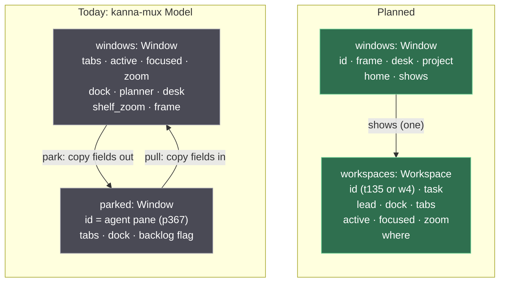
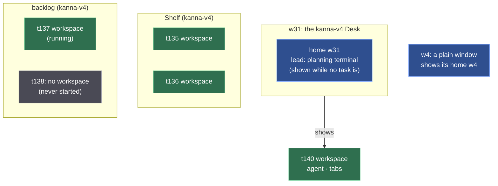
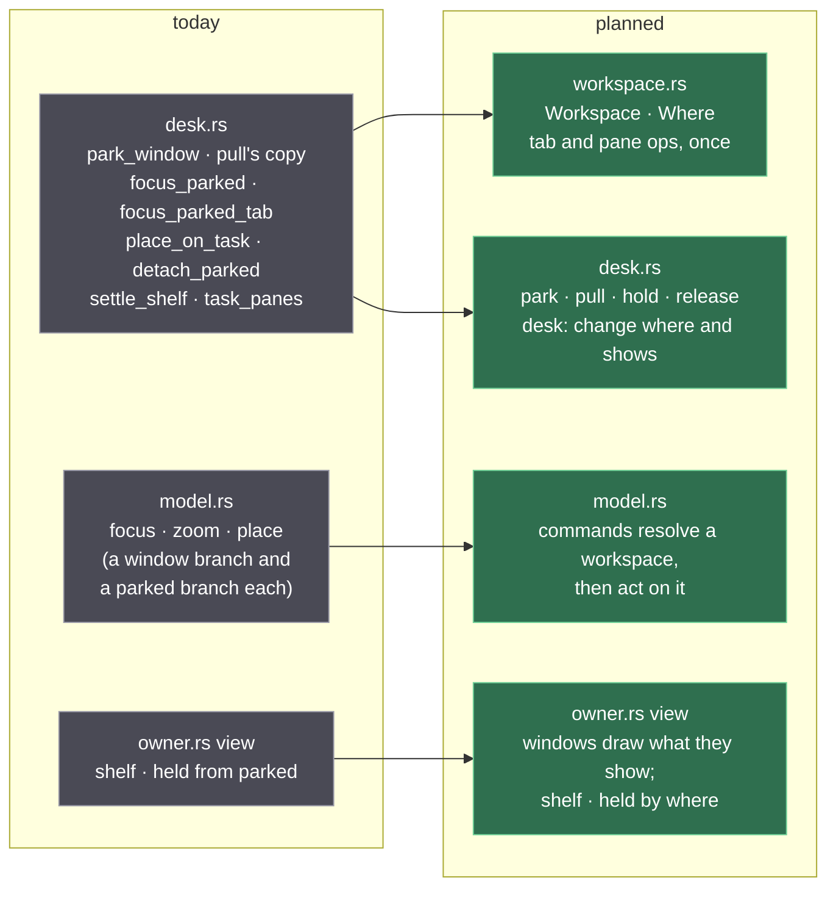

# Workspaces

**Status:** planned · **Builds on:** [layout](layout.md), [Desk](desk.md), [tasks](tasks.md), [presenting](presenting.md) · **Folds in:** backlog task t135 (off-screen replies)

A task is a unit of work; its **workspace** is how it's presented: its agent docked beside its tabs, with the shown tab, focus and zoom. A window shows a workspace. Today a task has no such object. On a Desk its parts are fields of the window; parked or held they're copied out into a `Window`-shaped record with the agent pane's ID. So a window ID like `w31` names a place, not a task. A command aimed at a window hits whichever task is shown there (an agent's diff tab landed in another task's workspace that way), and a reply about an off-screen task names the key window or says the app isn't open.

With workspaces, a window *shows* one workspace. Park, pull, hold and shelve change which window shows which, and copy nothing. A command from a task's pane goes to its own workspace, wherever that is, and the reply names the task and where it is. `--window` only ever means a place.

## Contents

1. [The model, before and after](#1-the-model-before-and-after)
2. [What moves a workspace](#2-what-moves-a-workspace)
3. [Commands: target and reply](#3-commands-target-and-reply)
4. [Plain windows and the planning terminal](#4-plain-windows-and-the-planning-terminal)
5. [Saved state](#5-saved-state)
6. [Code and tests](#6-code-and-tests)
7. [The branches waiting for review](#7-the-branches-waiting-for-review)
8. [Questions](#8-questions)
9. [Glossary](#9-glossary)

## 1. The model, before and after



- **A workspace's ID is its task's ID** (`t135`, the one in `kanna task list`). It keeps it from start to Done, wherever it goes.
- **Every window has a home workspace** with the window's own ID (`w4`). It never moves. A plain window always shows it. A Desk shows it while no task is on the Desk: its planning terminal (the lead) beside the Shelf ([4](#4-plain-windows-and-the-planning-terminal)).
- **`where`** is one of: shown in a window, on the Shelf, or in the backlog. A task workspace is in exactly one place, and at most one window shows it.



Green: task workspaces. Blue: windows and their homes. Grey: today's model, or no workspace.

A backlog task gets a workspace when it first starts; until then it's only a name and a first message ([tasks](tasks.md#3-the-backlog)). Hidden workspaces still run their panes at the Desk's size ([pane sizes](pane-sizes.md)).

## 2. What moves a workspace

Each one changes `where` and a window's `shows`. None copies tabs, focus or zoom.

| Action | Workspace | Window |
|---|---|---|
| `kanna task start` (backlog) | new `t…`, docked agent, in the backlog | — |
| Move to Shelf (`shelve`) | new, or the held one, onto the Shelf | — |
| `pull` onto W | Shelf → shown in W | W shows it; the one W showed goes to the Shelf |
| `park` | shown → Shelf | W shows its home |
| Move to Backlog (`defer`, `hold`) | Desk or Shelf → backlog, as it is | W shows its home if it showed it |
| `stop` | unchanged | unchanged |
| `done` | closed with its panes | W shows its home if it showed it |
| Its agent's pane closes | its tabs leave for a new plain window (today's rule) | W shows its home |
| `move PANE --window W` | the pane leaves its workspace for W's shown one | — |
| A tab dragged to W, or `move-tab` | the tab leaves its workspace for W's shown one | — |
| A tab dragged out of every window | the tab becomes a new plain window's home | new window |

A pane belongs to the workspace it's in. Moving it to another window moves it to another task, so that's always a deliberate drag or `move`, never a side effect of where a task happens to be shown.

## 3. Commands: target and reply

**The caller** is the CLI's `$KANNA_PANE` (today's `opener`). Its workspace is the one it's in. A command that names a pane or tab acts on *that* pane's workspace. One that names nothing acts on the caller's. `--window W` is a place: W's shown workspace. A task's pane may aim there too, though it rarely needs to; the reply then names the other workspace, so the agent sees where its pane went.

| Command | From a task's pane (t135) | From a plain pane (in w4) |
|---|---|---|
| `open` | into t135: as asked when shown; a new tab when hidden (today's rule) | into w4, as today |
| `focus PANE` / `--tab` | that pane's workspace's shown tab and focus; the window becomes key only if it shows it | as today |
| `focus --window W` | makes W key; changes no workspace | as today |
| `zoom PANE` | that pane's workspace's zoom, shown or not | as today |
| `comment` | the markdown pane it opens or finds is in t135 | in w4 |
| `move` | `--window W` into W's shown workspace | as today |
| `close` | a pane, a tab, or `--window W` (W and the workspace it shows) | as today |
| `list` | every window and what it shows, then each Shelf and backlog workspace with its tabs | the same |

Replies say which workspace, and where it is. The window is named only when one shows it:

| Case | Today | Planned |
|---|---|---|
| open, t135 shown in w31 | `opened p5 in window w31, tab t9: running` | `opened p5 in t135 on w31, tab t9: running` |
| open, t135 on the Shelf | `opened p5, unplaced until Kanna.app opens: running` | `opened p5 in t135 (on the Shelf), tab t9: running` |
| open, t135 in the backlog | the same | `opened p5 in t135 (in the backlog), tab t9: running` |
| open `--window w31`, from t135, w31 shows t140 | `opened p5 in window w31, tab t9: running` | `opened p5 in t140 on w31, tab t9: running` |
| open, no app | `opened p5, unplaced until Kanna.app opens: running` | unchanged |
| focus, t135 held | `focused spec (key window w31)` | `focused spec in t135 (in the backlog)` |
| focus, t135 shown | `focused spec (key window w31)` | `focused spec in t135 on w31 (key window)` |
| focus, plain | `focused p5 (key window w4)` | `focused p5 in w4 (key window)` |
| zoom, hidden | `spec is zoomed (run again to unzoom)` | `spec is zoomed in t135 (on the Shelf; run again to unzoom)` |
| comment, hidden | `opened p6 · spec.md:12` | `opened p6 in t135 (on the Shelf) · spec.md:12` |

Layout replies carry `workspace: {id, task, where}`, with `where` being `{window}`, `"shelf"` or `"backlog"`, beside the `window` and `tab` they have today. `window` is null only when no window shows the workspace. The CLI writes "unplaced until Kanna.app opens" only when there's no `workspace` either (the app wasn't there). `kanna list --json` gains `workspaces`, and each pane's row names its workspace.

## 4. Plain windows and the planning terminal

- **A plain window** (no Desk: `kanna open --window new`, a torn-off tab) shows its home workspace and nothing else. Nothing parks, pulls or docks there. Its tabs, focus and zoom are its home's, so kmux's protocol cases see the same window as today.
- **A Desk's home** holds its planning terminal (`planner`, the lead) and the Shelf's own zoom (today's `shelf_zoom` becomes the home's `zoom`). It holds no tabs: a pane opened there goes to a new window, as today ([zoom](zoom.md), [planning agent](planning-agent.md)).
- **The planning terminal never moves.** It's its window's, not a task's: park and pull swap the task workspace around it, and `move` still refuses it.

## 5. Saved state

`layout.json` goes to `version: 2`: windows hold only their own fields, and every workspace is in one list.

```json
{ "kmux": "state", "version": 2, "key": "w31",
  "windows": [{ "id": "w31", "frame": {}, "desk": true, "project": "/work/app", "home": "w31", "shows": "t140" }],
  "workspaces": [
    { "id": "w31", "lead": { "pane": "p2", "width": 0.4 }, "tabs": [], "zoomed": null },
    { "id": "t140", "task": "t140", "dock": { "pane": "p12", "edge": "left", "width": 0.4, "frozen": true },
      "tabs": [], "active": "t9", "focused": "p13", "zoomed": null, "tabCount": 3 },
    { "id": "t135", "task": "t135", "where": "shelf", "parkedAt": 1792183838, "dock": {}, "tabs": [] },
    { "id": "t137", "task": "t137", "where": "backlog", "dock": {}, "tabs": [] }] }
```

- **Version 1 still loads.** Each window becomes a window plus its home (`planner` → `lead`, `shelfZoom` → `zoom`). A window with a dock also gets a task workspace that it shows. Each `parked` entry becomes a workspace on the Shelf, or in the backlog when `backlog` is set. The next save writes version 2.
- **Task IDs come from the daemon.** A version-1 file only knows agent pane IDs (`p367`). The daemon's hello reply already lists its terminals, and it adds `task: "t135"` to each task's agent pane (from `tasks.pane` in `kanna.db`). The app renames each workspace from pane to task ID. A docked pane with no task keeps its pane ID as the workspace's ID until it's closed.
- **New workspaces get the ID in `place`:** the daemon's `open --dock --frozen` for a task sends `at: {dock, shelf | backlog, task: "t135"}`.
- **The daemon's own state doesn't change.** `kanna.db` keeps `tasks.pane` (the agent) and `place`. `terminals.json` keeps the terminals. The layout's `where` is what's shown, and the db's `place` stays the task's history ([database](database.md)).

## 6. Code and tests



- **Out of desk.rs:** every `parked` lookup and copy. `focus_parked`, `focus_parked_tab`, the parked half of `place_on_task` and of `zoom`, and `detach_parked` become the workspace's own ops. `park_window` and the body of `pull` shrink to changing `where` and `shows`. `Window.backlog`, `parked_at` and `shelf_zoom` move to the workspace.
- **Out of owner.rs:** `view`'s `shelf` and `held` read workspaces by `where`. The view's shape for the Swift app doesn't change, so the app's drawing code doesn't either.
- **kanna CLI:** `output.rs` `opened`, `focused`, `zoomed`, `commented`, `moved` write the replies in [3](#3-commands-target-and-reply). `crates/kanna/tests/cli.rs` checks them.
- **kanna-mux tests:** the owner tests on parked and held tasks (`a_task_parks_onto_the_shelf…`, `a_task_held_in_the_backlog…` ×2, `a_task_parks_and_pulls_with_its_zoom…`, `a_parked_task_whose_agent_is_gone…`, `a_pull_onto_a_desk_with_a_task…`) check workspace IDs and `where` instead of `parked` records. New ones: a task's `open` lands in its own workspace after another task is pulled onto its old window; replies name the workspace; a version-1 file loads and saves as version 2 (`tests/restore.rs`). `protocol_cases` (kmux's) pass unchanged.
- **e2e:** `backlog_runners` (the presenting task) checks the new focus and open replies from a held task, and that its tabs are still in `t8`'s workspace after another task is pulled onto the Desk. `desk_shelf`, `move_to_backlog`, `backlog_and_back`, `shelf_zoom` and `layout_restored` read workspaces from `kanna list --json`.
- **Skills:** `kanna-tasks` already says to open without `--window`. It gains one line: the reply names your task and where it is.

## 7. The branches waiting for review

- **Quiz window docks its agent** (`quiz-window-docked`) renames `planner` to `lead` and lets a plain window have one (the Quiz window). That fits: the lead lives in the window's home workspace, so a Quiz window is a plain window whose home has a lead and tabs. Land it first. This spec then says `lead` throughout, and version 1's `planner` loads as `lead`.
- **Move to a window makes a new tab** (`move-window-new-tab`): `move PANE --window W` makes a new tab at the end of W. With workspaces that tab is in W's shown workspace. No conflict: it changes `move_pane`'s destination, and this spec changes how W resolves to a workspace.

## 8. Decisions and questions

1. **The name is workspace.** A task is the unit of work; its workspace is its presentation. The Shelf and the backlog hold tasks, and each started task's workspace goes with it, hidden; the Shelf draws the cards it draws today.
2. **A task's pane may open into another window** with `--window W`. It's rare, not wrong. The reply names the workspace it landed in.
3. **t135** ("Off-screen open and focus replies name the right window"), a backlog task made by the agent of 'Presentations focus the first tab' for the two misleading replies, is covered by [3](#3-commands-target-and-reply) and comes off the backlog when the build task is made.
4. **Open: does a plain window have a workspace?** A plain window is one that isn't a Desk (`kanna open --window new`, a torn-off tab): no task docks there. *Recommend* yes, its home workspace: every window then shows a workspace, so the tab, focus and zoom code is one path. The other choice keeps tabs on plain windows and puts workspaces only on tasks, which keeps two paths, as today.

## 9. Glossary

| Term | Meaning |
|---|---|
| **Task** | A unit of work: one agent in one repo ([tasks](tasks.md)) |
| **Workspace** | How a task is presented: its agent dock, tabs, shown tab, focus and zoom, with the task's ID; or a window's home |
| **Home workspace** | A window's own workspace, with the window's ID; holds a Desk's lead, or a plain window's tabs |
| **Shows** | The one workspace a window draws |
| **Where** | A workspace's place: shown in a window, on the Shelf, or in the backlog |
| **Caller** | The pane a CLI command runs in (`$KANNA_PANE`); its workspace is the default target |
| **Lead** | A window's own agent (the planning terminal on a Desk), never a task |
