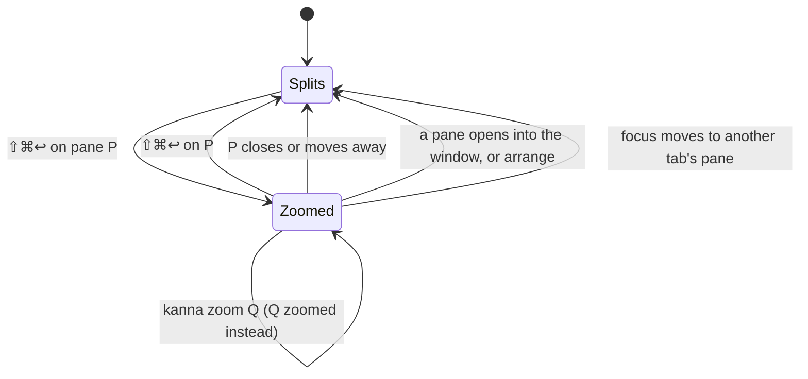

# Zoom

**Status:** built, in kmux and Kanna · **Reference:** kmux ([`references/kmux`](../../references/kmux/docs/kmux-spec.md), its §5 and protocol cases `focus.json` and `dock.json`) · **Used by:** [Docked pane](docked-pane.md), [Desk](desk.md)

**Zoom** lets one pane fill the window for a while, without changing the layout. ⇧⌘↩ turns it on and off. While a pane is zoomed, ⌘] and ⌘[ move the zoom from pane to pane.

| A tab with two panes beside the docked pane | ⇧⌘↩ on DOCK TAB THREE |
|---|---|
|  |  |

## Contents

1. [What fills what](#1-what-fills-what)
2. [Rules](#2-rules)
3. [Keys and CLI](#3-keys-and-cli)
4. [How it's built](#4-how-its-built)
5. [Glossary](#5-glossary)

## 1. What fills what

| Zoomed pane | Before | Zoomed |
|---|---|---|
| a tab's pane |  |  |
| the docked pane, with tabs |  |  |
| the docked pane, no tabs |  |  |

In a window without a docked pane, the zoomed pane fills the tab as in kmux.

## 2. Rules

- **One zoomed pane at a time** in a window. Zoom on another pane moves the zoom to that pane.
- **The zoom follows focus.** Next Pane (⌘]), Previous Pane (⌘[) and `kanna focus PANE` move the zoom to the pane they focus, if it's on screen: a pane in the shown tab, or the docked pane. Only ⇧⌘↩ (or `kanna zoom`) turns it off. A click can't move focus while zoomed, as only one pane shows.
- **A tab's pane zoom belongs to that tab.** Switching tabs leaves it, and it's there again when you come back. Focusing a pane in another tab cancels that tab's zoom unless the pane is the zoomed one.
- **The docked pane's zoom belongs to the window**, as the docked pane is in no tab. It works with no tabs, and switching tabs cancels it.
- **Cancelled by** closing or moving the zoomed pane, opening a pane into the window, docking a pane, and `arrange`.
- **Saved** in `layout.json`, so it's there after a relaunch: each tab's zoom with the tab, the window's with the window.

**Where Kanna differs from kmux.** kmux has one zoom per window, which switching tabs cancels, and a zoomed tab pane leaves the docked pane on screen. Kanna keeps a zoom per tab, and a zoomed tab pane fills the whole window, docked pane included. The protocol cases they share pass in both.

## 3. Keys and CLI

| Key or command | Does |
|---|---|
| ⇧⌘↩ (Pane menu, Zoom; Ghostty's `toggle_split_zoom`) | Zoom the focused pane, or unzoom it |
| ⌘] / ⌘[ | Next or Previous Pane; a zoom moves along |
| `kanna zoom PANE` | Zoom PANE, or unzoom it if it's zoomed |
| `kanna focus PANE` | Focus PANE; a zoom moves along if PANE is on screen |
| `kanna list` | Each window's `zoomed` pane |

## 4. How it's built

- **The core** (`crates/kanna-mux/src/model.rs`) keeps a tab pane's zoom on its `Tab` (`zoomed`) and the docked pane's on its `Window` (`dock_zoomed`, the pane's ID, so it lapses once that pane is no longer docked). `Window::zoomed()` answers which pane is zoomed: the docked pane if it's zoomed, else the shown tab's.
- **Focus** (`focus_pane`) checks whether the window is zoomed and the pane is on screen before it switches tabs. If both are true, the zoom moves to the pane; otherwise a different zoomed pane is unzoomed.
- **The view** the app draws has the zoomed pane as the window's whole tree (`root`), or no tree when the docked pane is zoomed ([kanna spec 4.7](../kanna-spec.md#47-the-layout)).
- **kmux first.** A change to zoom goes into kmux (its core, reference model, protocol cases and spec), then into Kanna with a subtree pull.
- **Checked by** kmux's protocol cases, run in kmux and in `kanna-mux`; the `kanna-mux` owner tests for per-tab zoom, the docked pane and relaunch; and e2e S11 (⌘] and ⌘[ through three zoomed panes) and S38 (the docked pane with and without tabs). S38's snapshots are this spec's pictures.

## 5. Glossary

| Term | Meaning |
|---|---|
| **Docked pane** | A window's one pane outside its tabs, along its left or right edge ([spec](docked-pane.md)). |
| **On screen** | A pane in the shown tab, or the docked pane. |
| **Protocol cases** | kmux's JSON request-and-reply scripts that kmux, its reference model and Kanna's core all run. |
