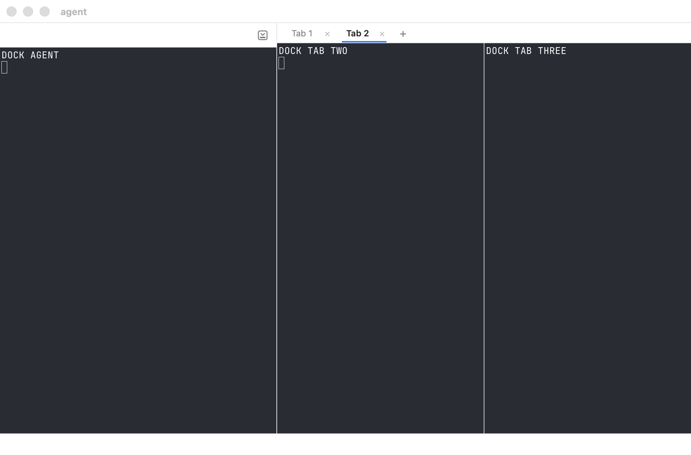
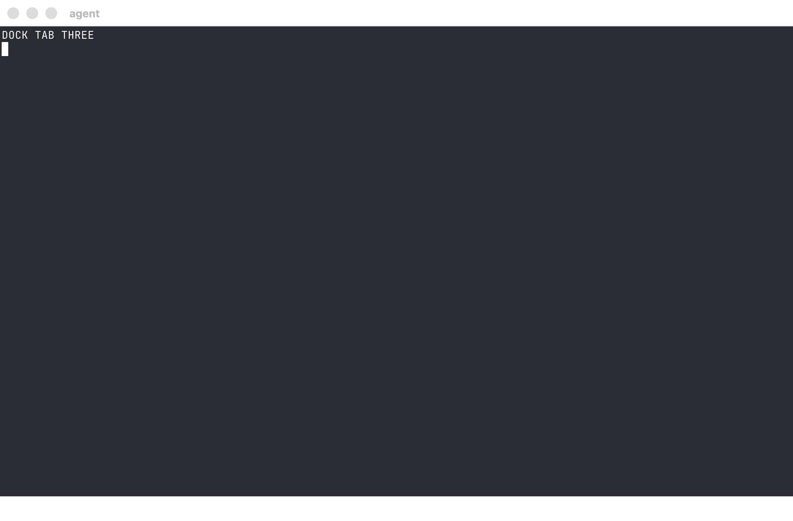
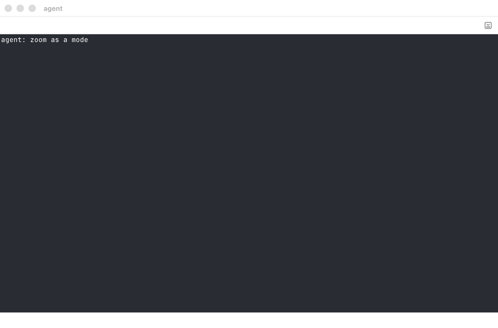
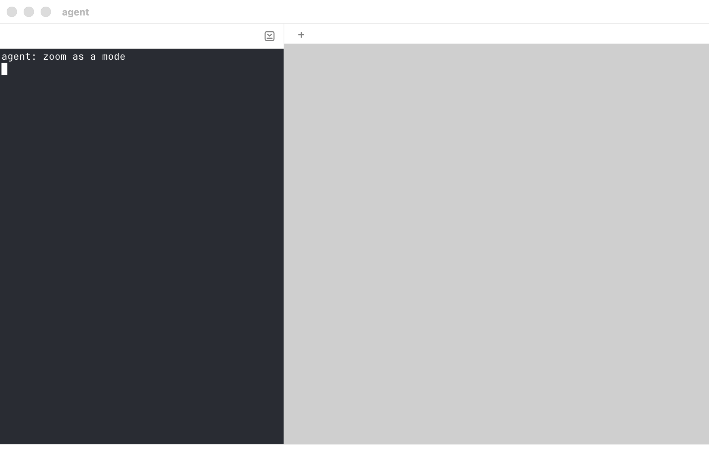
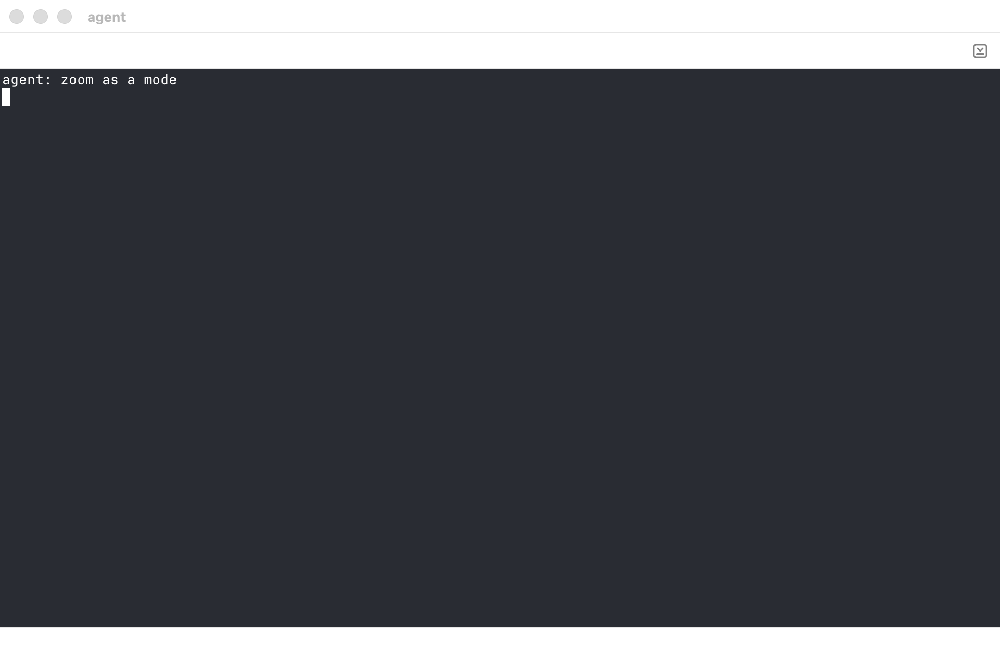

# Zoom

**Status:** built (2026-10-12), in kmux and Kanna · **Reference:** kmux ([`references/kmux`](../../references/kmux/docs/kmux-spec.md), its §5 and protocol cases `focus.json` and `dock.json`) · **Used by:** [Docked pane](docked-pane.md), [Desk](desk.md)

**Zoom** is a window's mode. ⇧⌘↩ turns it on and off; while it's on, whichever pane has focus fills the window, and the layout stays as it was underneath. You move around as usual, by pane (⌘] ⌘[) or by tab (⇧⌘] ⇧⌘[), and see one pane at a time.

| Zoom off: the agent docked, the server tab split in two | Zoom on, with the request log focused |
|---|---|
|  |  |

## Contents

1. [What fills what](#1-what-fills-what)
2. [Rules](#2-rules)
3. [Keys and CLI](#3-keys-and-cli)
4. [How it's built](#4-how-its-built)
5. [Glossary](#5-glossary)

## 1. What fills what

| Focused pane | Zoom off | Zoom on |
|---|---|---|
| a tab's pane |  |  |
| the docked pane, with tabs |  |  |
| the docked pane, no tabs |  |  |

In a window without a docked pane, the focused pane fills the tab as in kmux.

## 2. Rules

- **A mode of the window, not a mark on a pane.** While zoom is on, the window shows only its focused pane, filling the window. Each window has its own.
- **Moving around keeps it on.** Next and Previous Pane, Next and Previous Tab, and `kanna focus` move focus as they do with zoom off, and the pane they land on fills the window. Next Pane goes through the docked pane and the shown tab's panes, as it does with zoom off.
- **Only ⇧⌘↩ turns it off** (or `kanna zoom`), showing the layout again with focus where it ended up.
- **Opening, closing or moving panes keeps it on.** A pane opened into the window is focused, so it's the one shown; when the focused pane closes or moves away, the pane focused after it is shown.
- **Saved** in `layout.json` with the window, so it's on after a relaunch.

**The same in kmux.** kmux gets the mode, and Kanna's whole-window fill: a zoomed tab pane covers the docked pane there too, where today it fills only the tabs' side.

## 3. Keys and CLI

| Key or command | Does |
|---|---|
| ⇧⌘↩ (Pane menu, Zoom; Ghostty's `toggle_split_zoom`) | Turn the key window's zoom on or off |
| ⌘] / ⌘[, ⇧⌘] / ⇧⌘[ | Next or Previous Pane or Tab; with zoom on, the pane they land on fills the window |
| `kanna zoom PANE` | Focus PANE and turn its window's zoom on, or off if it's on |
| `kanna focus PANE` | Focus PANE; with zoom on, it fills the window |
| `kanna list` | Each window's `zoomed` pane: its focused pane while zoom is on |

## 4. How it's built

- **The core** (kmux's `Window.zoom`, then `crates/kanna-mux/src/model.rs`'s) keeps one flag per window. The zoomed pane is the window's focused pane while it's on (`Window::zoomed()`), so nothing moves a zoom from pane to pane or clears it when panes come and go.
- **The protocol and state file** keep their `zoomed` field: `list` and `layout.json` show the focused pane while zoom is on, and a saved `zoomed` turns zoom on, focused there, after a relaunch.
- **The view** the app draws has the focused pane as the window's whole tree (`root`), or no tree when it's the docked pane or a Desk's planning terminal, which then fills the window ([kanna spec 4.7](../kanna-spec.md#47-the-layout)).
- **kmux first.** The mode and the whole-window fill went into kmux (its core, reference model, protocol cases, app, e2e and spec), then into Kanna with a subtree pull.
- **Checked by** kmux's protocol cases (`focus.json`, `dock.json`), run in kmux, its reference model and `kanna-mux`; the `kanna-mux` owner test for the mode across tabs, a new pane and a relaunch; and e2e S11 (⌘] ⌘[ and ⇧⌘] ⇧⌘[ with zoom on, a new tab's pane shown) and S38 (the docked pane with and without tabs, ⌘] from it into the tabs). S38's snapshots are this spec's pictures.

## 5. Glossary

| Term | Meaning |
|---|---|
| **Docked pane** | A window's one pane outside its tabs, along its left or right edge ([spec](docked-pane.md)). |
| **Protocol cases** | kmux's JSON request-and-reply scripts that kmux, its reference model and Kanna's core all run. |
