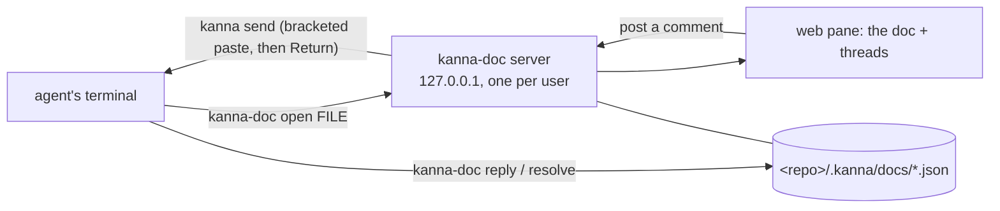

# Doc markup prototype

The reference model for [doc markup](../../docs/specs/doc-markup.md): comment on a markdown file in a Kanna pane, and the agent that opened it gets each comment in its terminal and answers with `kanna-doc`. It works with today's Kanna, as a web pane; nothing in the app or daemon changes.



## Try it

From the agent's terminal in Kanna (so the comments go there):

```
prototypes/doc-markup/kanna-doc open docs/specs/doc-markup.md
```

It opens the doc to the right. Select text and press ⌘↵ (or ⌘-click a word), write, ⌘↵ to post. The agent learns how to answer from the `kanna-doc` skill.

Put it on your `PATH` so agents can run `kanna-doc` from anywhere:

```
ln -s "$PWD/prototypes/doc-markup/kanna-doc" ~/.local/bin/kanna-doc
```

## What it is

- `kanna-doc`: the CLI (`open`, `comments`, `show`, `reply`, `resolve`, `reopen`, `comment`) and the server (`serve`, started by `open` when none is running). Python 3, standard library only.
- `page.html`: the doc pane. Markdown and mermaid render as in Kanna's markdown pane; comments are highlighted in place and listed beside it; it reloads when the file or the threads change.
- Threads: `<repo>/.kanna/docs/<path>.json`. The agent is the pane `open` ran in (`$KANNA_PANE`), and `$KANNA_SOCKET` picks the Kanna.
- Server: `~/.kanna-doc-prototype/` (`server.json` has its port, token and PID; `server.log`). `KANNA_DOC_PROTOTYPE_DIR` moves it.

## Where it differs from the spec

- It's a web pane, not Kanna's markdown pane, and needs the network once to load marked, mermaid and DOMPurify (pinned, with integrity hashes).
- The command is `kanna-doc`, not `kanna doc`.
- Threads are read and written by whichever process needs them (file lock), not owned by the daemon.
- Sending is two `kanna send`s: the comment as a bracketed paste (plain `send` would submit a multi-line comment at its first newline), then an empty one in case the agent took the paste's Return as part of the paste.

## Safety

The server listens on 127.0.0.1 only and every request needs the token in the URL. It serves only `.md` files, and images inside the doc's repo. Rendered markdown is sanitised (DOMPurify) and the page's Content-Security-Policy allows only its own script and the three pinned libraries, so a doc can't run script, which could otherwise post comments and so type into the agent's terminal.
